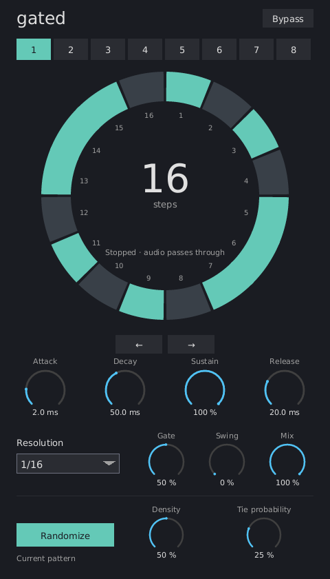

{ width=65% }

## What is Gated?

Gated chops incoming audio using a repeating rhythmic pattern. Eight slots hold
on/off steps and ties, shaped by a shared ADSR envelope. Swing changes the groove;
random population creates new rhythms without changing your sound controls.

## Installation

Build VST3, CLAP, and standalone with:

```bash
cargo xtask bundle -p gated --native
```

Bundles are written under `target/bundled/`. Copy the VST3 or CLAP bundle into
your DAW's plugin directory. For GUI-only evaluation without an audio device:

```bash
cargo run -p gated -- --backend dummy
```

## Quick start

1. Insert Gated on sustained audio and start the DAW transport.
2. Try the eight numbered slots for different starting rhythms. Click ring
   segments to turn steps off or on.
3. Drag across segments to enable and tie a longer held gate.
4. Adjust Gate and Release for choppy or flowing articulation. Add Swing.
5. Select another numbered slot to edit and hear another rhythm, or use Randomize.

## Controls

| Control | Range / default | Behavior |
|---|---|---|
| Pattern | 1–8 / 1 | Selects both the playing and edited slot; automatable. |
| Steps | 1–64 / varies by slot | Drag the large central number up/down to change this slot's length. Hold Shift for fine adjustment. |
| Attack | 0–2000 ms / 2 ms | Time from zero to full level. |
| Decay | 0–2000 ms / 50 ms | Time from full level to Sustain. |
| Sustain | 0–100% / 100% | Held level after Attack and Decay. |
| Release | 0–4000 ms / 20 ms | Time from the note-off level to silence. |
| Resolution | 1/1–1/64 / 1/16 | Step duration; D = dotted, T = triplet. |
| Gate | 1–100% / 50% | Portion of the final step held before Release. |
| Swing | 0–100% / 0% | Equal step pairs through a 3:1 long/short groove. |
| Mix | 0–100% / 100% | Linear blend of dry audio and gated audio. |
| Density | 0–100% / 50% | Chance that Randomize turns each step on. |
| Tie probability | 0–100% / 25% | Chance of a tie between adjacent on steps. |
| Bypass | Off | Passes input through while the clock follows the song. |

The steps, ties, and length belong to each slot. All other controls are global.
New instances start with eight different rhythms, including ties. Slots 1, 2,
and 4–7 use 16 steps; slot 3 uses 32 and slot 8 uses 64. These are adapted from
the initial Trance Gate patterns recorded by the independently developed
[synthahol-phase-plant reader](https://github.com/softdevca/synthahol-phase-plant/blob/12226ba38afdf887214ffad9a14c191ef3e3d0ca/src/effect/trance_gate.rs).
All slots remain editable. Saved projects retain their stored patterns.

Double-click a numbered slot to restore its own factory steps, ties, and length.
The reset affects only that slot and is one undoable edit. A single click selects
the slot for editing and playback as usual.

## Pattern editing

Click a segment to toggle it. Drag clockwise or counterclockwise to turn on and
tie a run of steps. Hold Shift while dragging to paint steps off. Right-click
an active step to toggle its tie to the next step; both steps must be on. A tie
from the last step to the first continues across the loop boundary.

Untied on steps restart the envelope. Tied steps hold it, with Gate shortening
only the last step of the run. An entirely on, entirely tied pattern holds at
Sustain. Shortening a pattern retains hidden step data for later expansion.

Drag the large step count upward to lengthen the pattern or downward to shorten
it. Hold Shift for fine adjustment. The number highlights and shows a drag hint
on hover. Each drag is one undo action, including edits completed by focus loss.

The Copy/Paste shortcuts transfer a slot's complete pattern and length. The arrow
buttons rotate the visible steps and ties one step left/right. Randomize changes only
the current slot's visible steps and ties. It preserves length, hidden steps,
other slots, and global controls. Density zero intentionally produces silence.

The Undo/Redo shortcuts operate on pattern changes. A drag or randomization is
one undo action. Pattern history and the internal clipboard last while the editor is
open; recalling externally saved pattern state clears the history.

## Timing and swing

Step one is anchored to musical beat zero. Starting playback in the middle of
the song, seeking, and looping select the corresponding pattern position.
Changing slots switches immediately at the incoming pattern's current song
position; it does not restart the rhythm.

Swing delays the second step of each pair without changing the pair's total
duration. Pairing starts again at each pattern cycle. For odd lengths, the last
unpaired step stays straight. Swing applies to dotted and triplet resolutions too.

When transport stops, input passes through. A short gain slew avoids abrupt
changes during stops, bypass, pattern switches, and envelope retriggers. If the
host omits song position, Gated uses a tempo clock restarting on Play and displays
that limitation. A missing tempo falls back to 120 BPM.

## Mouse and keyboard

- Double-click a numbered slot to restore its factory pattern and length.
- Drag the large step count up/down to change length; Shift enables fine adjustment.
- Drag a dial vertically; hold Shift for fine adjustment.
- Double-click a dial to restore its default.
- Right-click a dial to type a value; Enter commits, Escape cancels.
- Ctrl/Cmd+C and Ctrl/Cmd+V copy/paste patterns.
- Ctrl/Cmd+Z undoes; Ctrl/Cmd+Shift+Z or Ctrl/Cmd+Y redoes.
- The resolution menu supports arrows, Page Up/Down, Enter, Escape, and scrolling.

## Technical notes

Mono and stereo are supported. In stereo, the same gain applies to both channels.
There is no lookahead or FFT and no reported latency. The editor renders on the
CPU and scales to fit its freely resized window. Audio processing uses fixed
storage and a nonblocking copy of pattern state.

Version one exposes 64 steps. A later 128-step limit and Euclidean population
are planned separately.

## Formats and license

VST3, CLAP, and standalone. GPL-3.0-or-later, matching the plugin pack.

The initial pattern data is adapted from the Apache-2.0-licensed
synthahol-phase-plant project by Sheldon Young. Attribution and the upstream
license are included under `gated/THIRD_PARTY_NOTICES.md` and `gated/licenses/`.
