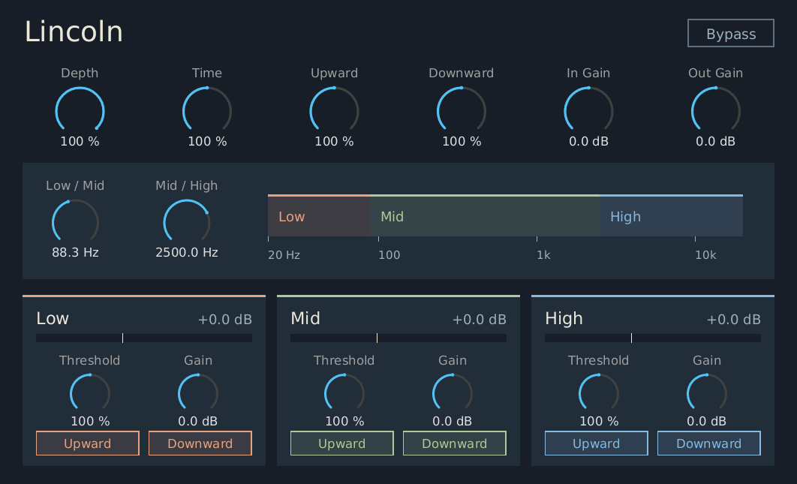

{ width=80% }

## What is Lincoln?

Lincoln is a three-band upward and downward compressor. It brings out quiet
detail and reduces loud peaks independently in the low, mid, and high bands.
The factory sound is modelled on Xfer OTT 1.37. Two adjustable crossover
frequencies let you choose where each band begins and ends.

## Installation

Copy `lincoln.vst3` or `lincoln.clap` into a plug-in directory scanned by your
DAW, then rescan. The usual user directories on Linux are `~/.vst3/` and
`~/.clap/`. On Windows, the usual system directories are
`C:\Program Files\Common Files\VST3\` and `C:\Program Files\Common Files\CLAP\`.
For macOS paths and Gatekeeper instructions, see [Installing the plug-ins on
macOS](../installing-macos.md).

To build VST3, CLAP, and standalone from the source checkout, run

```bash
cargo xtask bundle -p lincoln --redistributable
```

The builds appear under `target/bundled/`. The standalone is named `lincoln`
(with the platform's executable or app extension where applicable).

## Quick start

1. Insert Lincoln on a drum loop or other audio with quiet detail between loud
   hits. Set **Depth** to about 25% for a gentler starting point, then play the
   track.
2. Watch the three gain meters. Raise **Depth** to hear more compression. Lower
   **Upward** if the quiet material comes forward too strongly. Lower
   **Downward** if you want to retain more of the loud peaks.
3. Adjust **Low / Mid** to decide how much of the bass shares the low-band
   detector. Adjust **Mid / High** to choose where the high band begins. Watch
   the band map as you move each split.
4. Toggle **Bypass** to compare with the input. Adjust **Out Gain** until both
   versions have similar loudness so you can hear how the dynamics changed.

## Controls

### Global

| Control | Range / factory | Behaviour |
|--------------|----------------------|--------------------------------------------------------|
| Depth | 0–100% / 100% | Scales upward and downward compression and the automatic makeup gain. At 0% the crossover and manual gains still apply. |
| Time | 0–1,000% / 100% | Sets the release speed of all three detectors. Higher values recover more slowly. Attack timing is fixed per band. |
| Upward | 0–200% / 100% | Sets how strongly quiet signals are lifted. At 0% the upward branch is disabled across all three bands. |
| Downward | 0–200% / 100% | Sets how strongly loud signals are reduced. At 0% the downward branch is disabled. Further increases after the ratio reaches its ceiling lower the downward knee by up to 12 dB. |
| In Gain | −∞ to +19.1 dB / 0 dB | Trims the signal before it reaches the crossover and detectors. It changes which parts of the signal trigger compression. |
| Out Gain | −∞ to +19.1 dB / 0 dB | Trims the recombined signal after compression. |
| Bypass | Off / on, factory off | Passes the original input through while Lincoln's crossover and detectors continue to track the signal. |

### Crossovers

| Control | Factory | Behaviour |
|---|---|---|
| Low / Mid | 88.3 Hz | Boundary between the low and mid bands. |
| Mid / High | 2,500 Hz | Boundary between the mid and high bands. |

Both frequency dials span 20 Hz to 20 kHz and support host automation. The
effective upper limit is 45% of the sample rate, up to 20 kHz. Lincoln keeps the
bands in order with at least one semitone between the splits. When host targets
conflict, the lower split is limited by the upper split. The band map shows the
frequencies actually applied during audio processing, including the short
transition after an automated change.

### Low, Mid, and High bands

| Control | Range / factory | Behaviour |
|--------------|----------------------|--------------------------------------------------------|
| Threshold | 0–200% / 100% | Moves both compression knees in the selected band. Raising it increases upward lift and reduces downward gain reduction at the same input level. |
| Gain | −∞ to +6.0 dB / 0 dB | Trims the band after dynamics. Set it to `-inf` to mute the band. |
| Upward | Off / on, factory on | Enables upward compression for this band while the button is lit. |
| Downward | Off / on, factory on | Enables downward compression for this band while the button is lit. |
| Gain meter | Signed dB | Shows the gain from compression and automatic makeup before the manual band Gain. Positive readings show boost. Negative readings show reduction. |

The DAW parameter list names the direction switches **Upward Bypass** and
**Downward Bypass**. Enabling either bypass turns off that branch for its band.

## How it works

**In Gain → crossover → linked dynamics and manual gain per band → band sum →
Out Gain.** Lincoln uses two fourth-order Linkwitz–Riley splits with nominal
24 dB/octave slopes. It rotates phase around the crossover frequencies and
gradually adds phase compensation as the splits move closer. This keeps the
bands from cancelling when the split frequencies are near each other.

In stereo, each detector follows the mean-square level of both channels and
applies the same gain to each channel. Upward lift has a 36 dB cap per band.
Time changes release in milliseconds consistently across sample rates. At
factory Time, the approximate detector release time constants are 32 ms for
Low and Mid and 15 ms for High.

Use **Bypass** for a dry comparison. At Depth 0% the compression and automatic
makeup are neutral, and the crossover still rotates phase. This matters if
you sum Lincoln's output with an untreated copy of the same signal.

## Mouse and keyboard

- Drag a dial vertically. Hold **Shift** for finer adjustments.
- Double-click a dial to restore its factory value.
- Right-click a dial for numeric entry. Use **Ctrl+A** or **Cmd+A** to clear the
  field, **Enter** to apply, and **Escape** to cancel. You can enter a split as
  `2500` or `2.5 kHz` and mute a gain control by entering `-inf`.
- When a DAW modulates a dial, the readout shows the effective setting. Dragging
  and numeric entry use the base setting before the modulation offset.
- Drag a window edge to resize. The plug-in saves its editor size with the
  session.

## Formats and licence

Lincoln supports mono and linked stereo and reports zero samples of latency.
The editor renders on the CPU. Formats are VST3, CLAP, and standalone. Lincoln
is distributed under GPL-3.0-or-later with the Tract Plugin Pack.
