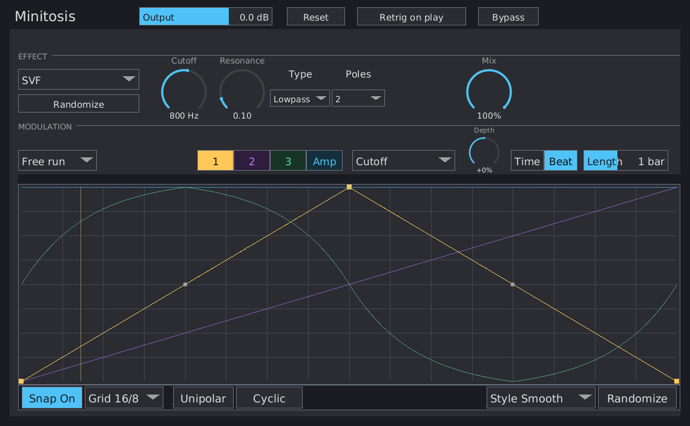

# Minitosis Manual

Minitosis runs one Multosis effect continuously, with three assignable MSEGs and an amplitude envelope. It shares Multosis's effect library and editor, without the sequencer or track list. Available as VST3, CLAP, and standalone.

{ width=80% }

## Getting started

1. Insert Minitosis on a stereo track. A fresh instance selects **None** and passes audio through.
2. Open the effect picker and select an effect. Effects are grouped into the same families as Multosis.
3. Set the effect's parameters. Their names, ranges, and defaults match the [Multosis effect reference](../multosis/multosis-manual.md).
4. To modulate a parameter, choose MSEG **1**, **2**, or **3**, select a **Target**, and change **Depth** from its default zero. At **0% Depth**, the MSEG has no effect on the target, even while the curve is running. Try **+30%** or **−30%** for a sweep in either direction. A hint in the modulation header reminds you when Depth is zero.
5. Draw a curve and adjust **Time/Beat** and **Length**. Free-running modes continue while the host transport is stopped; DAW-position mode holds the reported cursor.

## Effect controls

Continuous dials support vertical dragging, Shift for fine adjustment, double-click to reset, and right-click numeric entry. Enter commits a typed value; Escape cancels. Clicking another control commits the entry. Discrete parameters use dropdown menus. Colored arcs show MSEG modulation around each dial's base value.

**Randomize** changes the current effect's parameters while preserving Mix. With None selected, it also chooses an effect. Switching away and back recalls each effect's parameters and modulation settings. Audio state starts fresh on each switch; an old reverb or delay tail is not recalled. A **Preparing…** label appears while the replacement is being prepared, with dry audio passed during the transition.

## Global controls

- **Mix:** one dry/wet blend, default 100%. The dry path is aligned with the effect's reported latency. Amp changes the wet contribution; Mix at 0% remains dry.
- **Output:** post-blend gain, −30 to +12 dB, default 0 dB. Drag, fine-adjust, reset, and right-click-to-type are supported.
- **Bypass:** latency-aligned dry audio without Output gain. The engine keeps running so modulation and tails remain current.
- **Retrig on play:** optionally restarts all four MSEGs when transport starts. Off by default.
- **Reset:** restarts modulation without clearing audio tails.

None remains passthrough regardless of its Amp curve; Output still applies unless bypassed.

## MSEGs

The shared [curve tools](../mseg-editor.md) provide shape pens, draggable selection
handles, reusable curves/favorites, copy/paste between plugins, controlled
mutation, transforms, and triplet grids. Find them in **Tool**, **Shapes**, and
**Edit** beneath the curve. Each curve command or gesture is one undo step.

**Shapes → Browse shapes...** previews factory curves and shared favorites.
Load/Fit applies the selected thumbnail; Store/Clear manages shared slots. See
[browsing thumbnails](../mseg-editor.md#browsing-thumbnails).

The browser's **Project** tab adds eight waves saved with this instance and
shared across its effects. See [project waves](../mseg-editor.md#project-waves).

**Waves...** beside the curve's playback control configures MIDI switching of
those Project waves for Amp/1/2/3. Notes select waves at their sample offsets
while the clock keeps running; Trigger still controls restarts. The chosen
curve becomes a read-only playback preview until switching is Off. See
[MIDI wave switching](../mseg-editor.md#midi-wave-switching).

The same panel's **Wave Amp/1/2/3** field selects Drawn/MIDI or Project 1–8 for
the displayed curve. Each effect has four independent host automation lanes;
a Project value overrides MIDI while preserving phase and smoothing. See
[Wave automation](../mseg-editor.md#wave-automation).

Hover for footer hints, or click **?** beside Point for the gesture guide.
**F1 / ?** and **View → Editing guide...** also open it; see
[context help](../mseg-editor.md#context-help-and-gesture-guide).

Grid also offers **Semitones** for routed pitch and logarithmic frequency
targets, following base value, Depth, and polarity. See
[semitone grids](../mseg-editor.md#semitone-grids).

Edit also provides endpoint matching and **Smooth loop seam (10%)**; amber
marks identify playback wrap jumps, including stepped tails. See
[loop seam tools](../mseg-editor.md#loop-seam-tools).

The **1 / 2 / 3 / Amp** tabs, curve gestures, snapping, ghost curves, target/depth routing, and curve randomization match [Multosis's MSEG editor](../multosis/multosis-manual.md#msegs-per-row-modulation). The amplitude curve defaults to full level; assignable depths default to zero.

**Smooth** adds a saved per-envelope lag (Off–1000 ms) before Depth/Target
mapping. **Trace** displays measured source output, while dial arcs display
the delivered target values. See [live smoothing and trace](../mseg-editor.md#live-smoothing-and-trace)
for timing, reset behavior, and numeric controls.

**Audio** adds a phase-aligned input/output magnitude backdrop beneath the
curve, with **Freeze** for editing against the captured sound. It measures
before Output gain. See [audio waveform backdrop](../mseg-editor.md#audio-waveform-backdrop).
The Audio menu also provides Magnitude/Combined/Stereo views and -12/0/+12 dB
display gain. These work on frozen captures and affect only the display.

**Mix** appears after the effect parameters in the Target menu. It modulates the dry/wet blend around the base Mix setting without changing the dial's base value or writing MSEG movement to host automation. A colored arc on Mix shows the effective blend, and curve-node tooltips show percentages. For a full-range blend following the curve, set Mix to **0%**, choose **Unipolar**, and set Depth to **+100%**. From Mix **100%**, use negative depth to move toward dry. Mix remains within 0–100%, with smooth transitions between modulation updates.

**Follow** beside Waves adds an audio-level envelope follower. Each curve has
its own Follow/Add/Multiply route and Amount; Input, filters, Gain, Threshold and
Attack/Hold/Release are shared by the current effect's four curves. See
[Envelope follower](../mseg-editor.md#envelope-follower).

Both detector/follower panels offer **Listen** (**L**) to audition filtered
Main/Sidechain input. It is temporary, keeps normal DSP running, and stops on
panel close, focus loss, resize or source replacement. See
[detector input audition](../mseg-editor.md#detector-input-audition).

Trigger choices apply to all four envelopes:

- **Free run:** no periodic phase reset; Cyclic envelopes loop at their own length.
- **Free Hz:** periodically restarts envelopes at the Rate setting.
- **Transient:** restarts on input onsets, with Sens and Hold controls.
- **Free Hz (sample) / Transient (sample):** opt-in sample-timed variants with
  the same Rate or Sens/Hold controls. Existing modes remain block-aligned; see
  [sample-timed triggers](../mseg-editor.md#sample-timed-hz-and-audio-triggers).
  Transient (sample) also exposes **Detect...** for an absolute level threshold,
  detector-only High-pass/Low-pass, and a measured level meter. These settings
  default to Off and save per effect; see [audio detector setup](../mseg-editor.md#audio-detector-setup).
  Detect's **Input** switches between Main and the external **Sidechain** bus;
  **Audio → Sidechain** displays its raw waveform. See [sidechain routing](../mseg-editor.md#external-sidechain).
  Detect also offers Envelope, Peak rise and RMS rise algorithms with a Detail
  control for response speed. Envelope/50% keeps the original timing; Sens/Hold
  retain their roles. See [audio detector setup](../mseg-editor.md#audio-detector-setup).
- **MIDI note:** restarts at matching note-on offsets, with Note (Any/0–127) and
  Ch. (Any/1–16) filters. Route MIDI to the plugin's note input. Note-off does not
  gate or release the envelopes; see [MIDI retriggering](../mseg-editor.md#midi-retriggering).
- **DAW position:** follows the song timeline using each curve's Time/Beat length.
  Seeks and host loops relocate the phase; stopped or unavailable clocks pause
  waveform capture. Geometry stays editable. See [DAW-position playback](../mseg-editor.md#daw-position-playback).
- **MIDI pitch:** the last matching note sets all four curves' rate and restarts
  them at its sample offset. Semi transposes -36..+36 semitones; Ch. filters the
  input channel. Note-off keeps running. Saved Time/Beat lengths return when
  leaving this mode. See [MIDI pitch playback](../mseg-editor.md#midi-pitch-playback).

Time clocks use seconds. Free Beat clocks use 120 BPM when tempo is unavailable;
DAW Beat clocks hold between reported positions without a tempo. One-shot
envelopes hold their final value until retriggered; in DAW mode their origin is
timeline zero. There are no sequencer cell triggers.

**Trigger → Timing...** opens **Audio delay** (0–4 ms, Transient (sample) only)
and **Retrigger blend** (0–20 ms) while retaining the current source. Both default
Off, save per effect and use local undo. See [trigger timing](../mseg-editor.md#trigger-timing).

## Automation and project state

Each effect's parameters have their own stable automation IDs and effect/family-prefixed names. An SVF Cutoff lane continues to control SVF Cutoff when another effect is selected. Inactive effects retain their parameter values. The selector is non-automatable, but editable in the plugin and the host's generic editor. Mix, Output, Bypass, and Retrig on play are host parameters.

MSEG modulation changes the effective sound without overwriting the automated base value. Curve shapes and routing are saved as project state. Ctrl+Z and Ctrl+Shift+Z/Ctrl+Y undo and redo selection and modulation edits; the host handles undo for automated parameter gestures.

Projects save all effects' settings, the selected effect, and window size. Instances are independent. Effects with FFT latency report the current delay to the host and align both dry/wet mixing and bypass.

## Standalone and builds

```bash
cargo build --bin minitosis
cargo run --bin minitosis -- --backend dummy
cargo xtask native nih-plug bundle minitosis --release
cargo xtask native build --bin minitosis --release
```

The dummy backend opens the editor without using an audio device. The standalone wrapper also supports the platform's audio backends; run `minitosis --help` for options.
