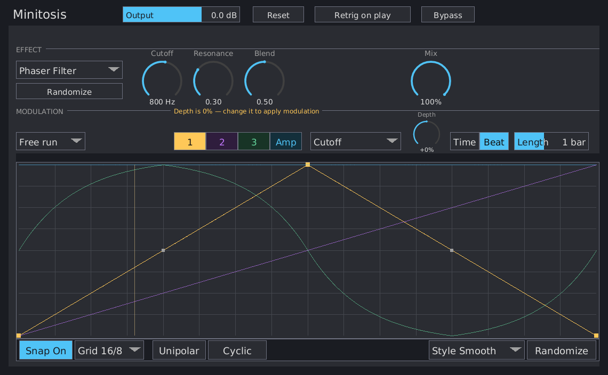

# Minitosis Manual

Minitosis runs one Multosis effect continuously, with three assignable MSEGs and an amplitude envelope. It shares Multosis's effect library and editor, without the sequencer or track list. Available as VST3, CLAP, and standalone.

{ width=80% }

## Getting started

1. Insert Minitosis on a stereo track. A fresh instance selects **None** and passes audio through.
2. Open the effect picker and select an effect. Effects are grouped into the same families as Multosis.
3. Set the effect's parameters. Their names, ranges, and defaults match the [Multosis effect reference](../multosis/multosis-manual.md).
4. To modulate a parameter, choose MSEG **1**, **2**, or **3**, select a **Target**, and change **Depth** from its default zero. At **0% Depth**, the MSEG has no effect on the target, even while the curve is running. Try **+30%** or **−30%** for a sweep in either direction. A hint in the modulation header reminds you when Depth is zero.
5. Draw a curve and adjust **Time/Beat** and **Length**. All four envelopes continue running while the host transport is stopped.

## Effect controls

Continuous dials support vertical dragging, Shift for fine adjustment, double-click to reset, and right-click numeric entry. Enter commits a typed value; Escape cancels. Clicking another control commits the entry. Discrete parameters use dropdown menus. Colored arcs show MSEG modulation around each dial's base value.

**Randomize** changes the current effect's parameters while preserving Mix. With None selected, it also chooses an effect. Switching away and back recalls each effect's parameters and modulation settings. Audio state starts fresh on each switch; an old reverb or delay tail is not recalled. A **Preparing…** label appears while the replacement is being prepared, with dry audio passed during the transition.

## Global controls

- **Mix:** one dry/wet blend, default 100%. The dry path is aligned with the effect's reported latency. Amp changes the wet contribution; Mix at 0% remains dry.
- **Output:** post-blend gain, −30 to +12 dB, default 0 dB. Drag, fine-adjust, reset, and right-click-to-type are supported.
- **Bypass:** latency-aligned dry audio without Output gain. The engine keeps running so modulation and tails remain current.
- **Retrig on play:** optionally restarts all four MSEGs when transport starts. Off by default.
- **Reset:** restarts modulation without clearing audio tails.

None remains passthrough regardless of its Amp curve; Output still applies unless bypassed.

## MSEGs

The **1 / 2 / 3 / Amp** tabs, curve gestures, snapping, ghost curves, target/depth routing, and curve randomization match [Multosis's MSEG editor](../multosis/multosis-manual.md#msegs-per-row-modulation). The amplitude curve defaults to full level; assignable depths default to zero.

Trigger choices apply to all four envelopes:

- **Free run:** no periodic phase reset; Cyclic envelopes loop at their own length.
- **Free Hz:** periodically restarts envelopes at the Rate setting.
- **Transient:** restarts on input onsets, with Sens and Hold controls.

Time clocks use seconds. Beat clocks follow host tempo, with 120 BPM used when tempo is unavailable. One-shot envelopes hold their final value until retriggered. There are no sequencer cell triggers.

## Automation and project state

Each effect's parameters have their own stable automation IDs and effect/family-prefixed names. An SVF Cutoff lane continues to control SVF Cutoff when another effect is selected. Inactive effects retain their parameter values. The selector is non-automatable, but editable in the plugin and the host's generic editor. Mix, Output, Bypass, and Retrig on play are host parameters.

MSEG modulation changes the effective sound without overwriting the automated base value. Curve shapes and routing are saved as project state. Ctrl+Z and Ctrl+Shift+Z/Ctrl+Y undo and redo selection and modulation edits; the host handles undo for automated parameter gestures.

Projects save all effects' settings, the selected effect, and window size. Instances are independent. Effects with FFT latency report the current delay to the host and align both dry/wet mixing and bypass.

## Standalone and builds

```bash
cargo build --bin minitosis
cargo run --bin minitosis -- --backend dummy
cargo xtask native nih-plug bundle minitosis --release
cargo xtask native build --bin minitosis --release
```

The dummy backend opens the editor without using an audio device. The standalone wrapper also supports the platform's audio backends; run `minitosis --help` for options.
