# MSEG editor guide

Multosis, Minitosis, Miff, and Nap share these editing tools. The **Tool**,
**Shapes**, **Edit**, and **View** menus sit beneath the existing curve controls.
Multosis/Minitosis provide playback and modulation routing; Miff/Nap use the
same geometry tools for their static kernel/tail curves.

## Make and save your first curve

1. Open **Shapes → Triangle**. The curve now has two endpoints and a peak in
   the middle.
2. Select the peak and click **Point**. Set **Value** to `0.75`, press Enter,
   and click outside the inspector. The peak moves down to the new level.

   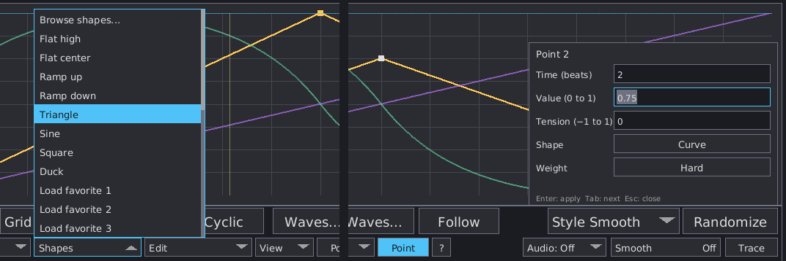

3. Open **Shapes → Browse shapes... → User → Save**. Enter a new name such as
   `Lower triangle` and click **Save**. The new thumbnail appears on the User tab.
4. Close the browser and choose **Shapes → Ramp up**. Return to the **User** tab.
   Select `Lower triangle` and click **Load** to recall the shape you just saved.

   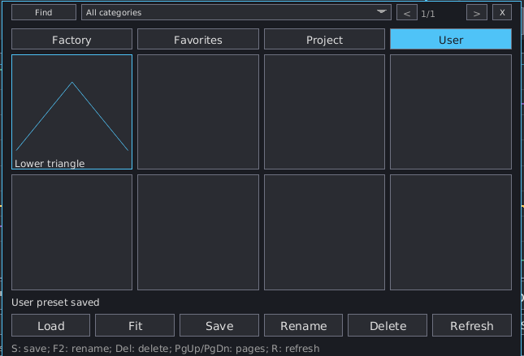

## Find a task or control

| To do this | Read this |
|---|---|
| Draw and repeat a segment | [Shape pens](#shape-pens) |
| Stretch, scale, or skew several points | [Selecting and transforming](#selecting-and-transforming) |
| Fix a jump when a curve loops | [Loop seam tools](#loop-seam-tools) |
| Save, favourite, or recall a shape | [Reusing curves](#reusing-curves) |
| Reuse part of a curve | [Copying and pasting a phrase](#copying-and-pasting-a-phrase) |
| Edit a point by number | [Precise points and navigation](#precise-points-and-navigation) |
| See what the envelope is doing during playback | [Live smoothing and trace](#live-smoothing-and-trace) |
| Pick or switch a Project shape during playback | [Waves panel](#midi-wave-switching) |
| Choose a periodic restart clock | [Free Hz and Free Hz (sample)](#free-hz-and-free-hz-sample) |
| Make a curve react to incoming audio | [Envelope follower](#envelope-follower) |

## Context help and gesture guide

Hover a curve control, point, handle, or empty canvas to see a short hint in the
footer. During a gesture, the hint describes that gesture. Multosis/Minitosis
also explain their modulation controls. Moving outside a pane or window clears
its hover hint; operation errors keep priority over hints.

Click **?** beside Point, choose **View → Editing guide...**, or press **F1 / ?**
to open the guide. In Nap, point at a pane before using the shortcut. Its four
pages cover **Points**, **Select**, **Shapes**, and **View**. Static editors omit
playback and routing controls unavailable in those plugins.

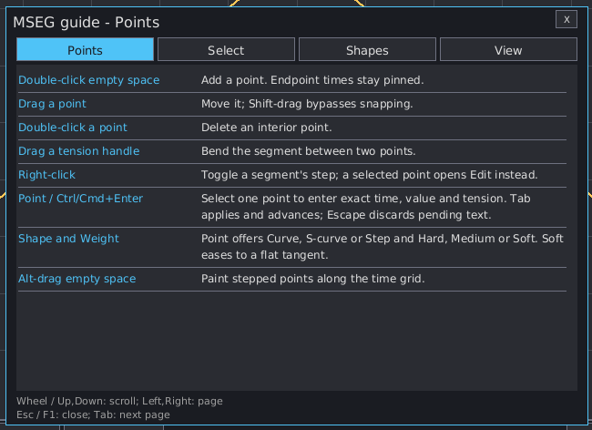

| Action | Controls |
|---|---|
| Scroll within a page | Wheel, Up/Down, Page Up/Down, Home/End |
| Change pages | Left/Right or Tab |
| Close | Escape, F1, ?, or X. An outside left-click or a right-click closes the guide without clicking through. |

Help preserves the curve, selection, tool and viewport, with no undo or bake
work. Numeric fields and existing menus keep keyboard priority; help shortcuts
wait until a drawing, pan, or dial gesture ends. Clicking Help commits a pending
host numeric value through the normal outside-click behavior. Resize and focus
loss close the guide.

## Shape pens

1. Choose **Line pen**, **Arc pen**, or **S-curve pen** from **Tool**. The white
   outline shows the next stamp.
2. Click to place the shape or drag to set its width, height, and direction.
   The pen remembers those dimensions for the next stamp.
3. Click again without moving the pointer to repeat. Repeats follow the direction
   of the drag and stop at the canvas edge. Move the pointer to start elsewhere.

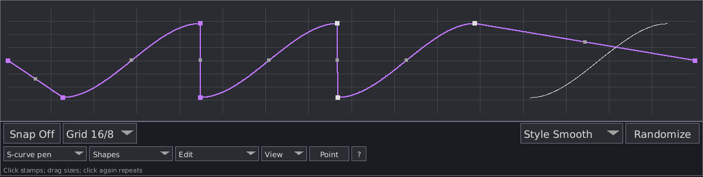

Each stamp replaces points within its span. An S-curve uses one segment with
two endpoints, and Arc uses tension. Repeated shapes can use a short transition
at their seams. Press **Escape** to cancel the gesture and return to Pointer.

### Native shapes and point weights

In **Point**, **Shape** sets how the segment leaves the selected point. The
last point has no outgoing segment.

| Shape | Result |
|---|---|
| **Curve** | Tension bends a straight segment into an arc. |
| **S-curve** | The segment eases in and out with flat ends. Tension moves the bend. |
| **Step** | The starting level holds until the next point. |

**Weight** sets the slope as a Curve segment meets the point. A filled **Hard**
point uses the standard slope, a dotted **Medium** point halves it, and a hollow
**Soft** point flattens it. All three keep the point's exact time and level.

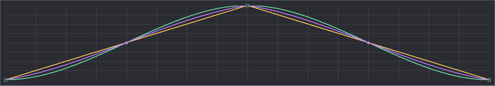

*Hard in amber, Medium in purple, Soft in teal.*

Native S-curves already have flat endpoints, so weights do not alter them.
Steps retain their hard jumps. A point's weight may still affect the other
adjacent Curve segment, including the incoming segment at the final point.
All new interpolation stays between its endpoints and uses the same sampler
for drawing, live modulation, Miff tap baking, and Nap sequence generation.

The factory **Sine** uses four editable points, with a native S-curve between
its peak and trough. It starts at the centre line, rising into the first peak.

Edit offers **Curve/S-curve/Stepped segments** and **Hard/Medium/Soft points**.
These act on the selected points, or all points when nothing is selected.
Segment commands skip the last point. Inspector style clicks first apply valid
pending numeric input; invalid text blocks the click. Each click/command is
one undo step in Multosis/Minitosis.

## Selecting and transforming

With **Pointer**, drag from empty space around the points or Ctrl-click them
individually. Two or more selected points display a box with eight handles.

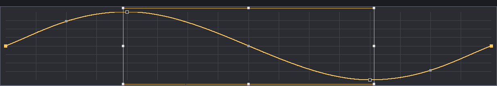

| Drag here | What changes |
|---|---|
| Left or right handle | Time |
| Top or bottom handle | Level |
| Corner | Time and level together |

Hold **Alt** to scale about the centre, **Ctrl** on an edge handle to skew
the other axis, or **Shift** to bypass snapping.

Endpoint times stay pinned to 0 and 1. Other points cannot cross their neighbors.
Dragging back to the initial handle position restores the initial geometry,
including after a boundary was reached. Escape cancels the gesture.

## Loop seam tools

Amber dashed marks and a **Loop seam jump** hint show where a cyclic curve or
hold loop wraps with a sudden level change. Choose a command from **Edit**.

| To do this | Choose |
|---|---|
| Copy the start level to the end point | **Match loop end to start** |
| Copy the end level to the start point | **Match loop start to end** |
| Ease the curve back to its starting level | **Smooth loop seam (10%)** |

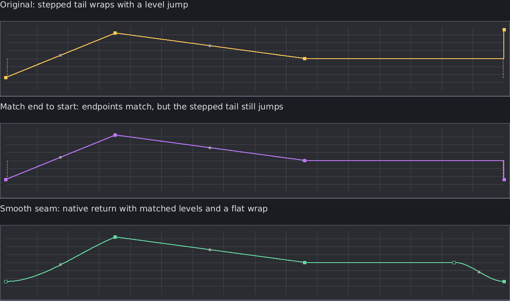

A stepped tail plays its held level all the way to the wrap, so matching the
endpoints can leave a jump. **Smooth loop seam (10%)** uses that held
level and adds a native S-curve over the last 10% of the loop. If that area
contains points, the return takes the last half-segment. A two-point ramp
keeps its original peak at the new return point. Already flat seams stay as drawn.

The commands act on the hold-loop region when present and on the whole curve
otherwise. In Miff and Nap they always act on the full static curve.

These commands edit the saved curve, including its first/last loop segments and
any interpolation sharing those boundary points. Selection and hold markers
follow existing nodes. Each change is one undo step in Multosis/Minitosis and
updates the static bake in Miff/Nap. Insufficient point capacity or room for a
return leaves the curve intact. Per-envelope [Smooth](#live-smoothing-and-trace)
provides the separate live lag control.

## Reusing curves

### Save the current shape

Open **Shapes → Browse shapes...** and choose where to keep the curve you drew.

| Tab | How to save | Where it is available |
|---|---|---|
| **User** | Click **Save**, enter a name, then click **Save** again. | Shared across Multosis, Minitosis, Miff, and Nap on this computer. |
| **Favorites** | Choose one of the eight slots and click **Store**. | Shared across those plugins, including future projects. |
| **Project** | Choose one of the eight slots and click **Store**. | Saved with this plugin instance, including its preset or DAW project. |

**Store** replaces the selected slot with the curve from the editor. To recall
a saved shape, select its thumbnail and click **Load**. **Fit** recalls it
within the current curve's level range. The saved shape contains geometry.
The receiving curve supplies its own length, trigger, and routing.

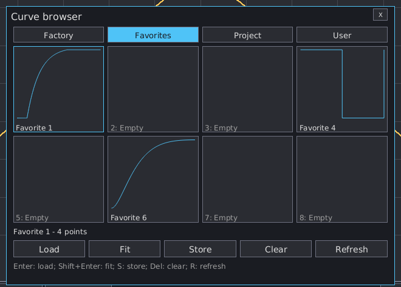

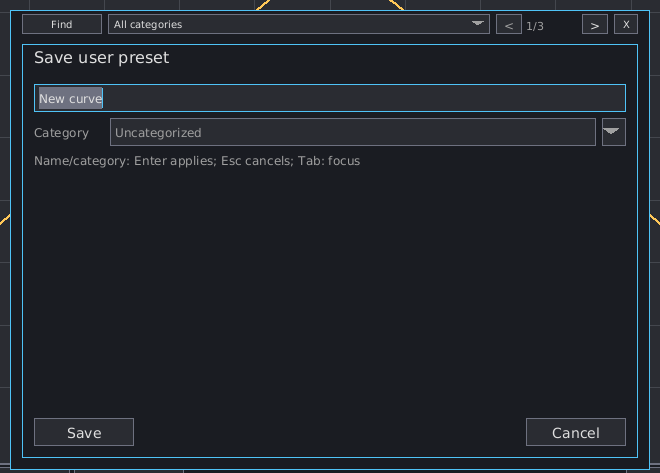

### Browsing thumbnails

Choose **Shapes → Browse shapes...** to see the eight **Factory** curves and
eight shared **Favorites** as thumbnails. Each plugin also provides eight
instance-local waves on the **Project** tab, plus named shared curves on **User**.
Click a thumbnail to select it, use
the arrow keys or Home/End to navigate, and use Tab/Shift+Tab to switch pages.
Selection leaves the current curve, viewport, tool, and remembered pen placement intact.

**Load** or Enter applies the selected shape. **Fit** or Shift+Enter fits its
height to the current curve's value range. Double-clicking a populated thumbnail
also loads it. Loading closes the browser, preserves timing/routing settings,
and clears hold markers and stale point selection as with other whole-curve
replacements. Each actual change is one undo step in Multosis/Minitosis and
updates the static curve in Miff/Nap.

On Favorites, **Store** or S saves the editor's current curve into the selected
slot, replacing its previous contents. **Clear** or Delete removes that shared
favorite. **Refresh** or R rereads the slots, including changes saved by other
instances. Store, Clear, and Refresh leave the editor's curve and undo history
unchanged. Existing favorite files and the older Load/Store menu commands use
the same slots.

Empty slots cannot load. Unreadable or invalid files show **Unavailable** with
details below the thumbnails; Store can replace them and Clear can remove them.
Storage failures leave the editor's curve intact. The browser keeps a snapshot
until Refresh or reopening, so previews and loading agree.

Escape, X, an outside left-click, or a right-click dismisses the browser without
acting underneath it. It owns mouse, wheel, and keyboard input across the window
and stays with its opening Nap pane. Resize and focus loss close it.
If the window is too short or narrow for the cards, the footer asks you to
enlarge it and the browser stays closed.

### Project waves

The **Project** bank saves with the plugin preset and DAW project. All curves
in one instance share its eight slots: Multosis rows, Minitosis effects, and
Nap panes can recall the same saved shapes. A new instance starts with empty
slots. The bank remains available when switching rows or effects.

On Project, **Store** or S captures the current curve into the selected slot;
**Clear** or Delete empties it. **Refresh** or R rereads the bank. These actions
leave the current curve, playback, baking and local curve undo unchanged.
**Load**/Enter, **Fit**/Shift+Enter and a thumbnail double-click recall geometry
using the existing curve-edit rules. Undoing a recall keeps the saved bank.
Curve clipboard/files also retain the destination's project bank.

Entering Project reads its current slots. If a restored preset or another pane
replaces the bank while the page is open, the first recall or storage action
refreshes the thumbnails without applying that action. Check the updated slots and choose
again. An unavailable bank reports an error and leaves the curve intact.

### Named user presets

The browser's **User** tab keeps up to 256 named curves, shared across all four
plugins, instances and host processes. It lives in the application-data library
alongside Favorites and the curve clipboard. User presets survive closing the
plugin and remain separate from plugin presets, DAW projects and Project waves.

**Save** or S captures the current curve and opens a name field. Enter or Save
creates a new preset. Names contain 1–64 Unicode characters, with surrounding
spaces trimmed. Names compare using Unicode lowercase; an existing name asks
you to choose another. **Rename** or F2 edits the selected preset's name while
retaining its curve. The field supports arrows, Home/End, Shift-selection,
Ctrl/Cmd+A, Backspace and Delete. Tab moves between Name, Category and the action
buttons.
Escape cancels the draft before closing the browser.

**Delete** or Delete/Backspace opens a confirmation showing the selected name.
Enter or the Delete button confirms; Escape or Cancel returns to browsing. Save, Rename
and Delete preserve the current curve, viewport, selection, pen repeat, local
undo and frozen capture. Long confirmation names wrap; Up/Down, Home/End,
Page Up/Down or the wheel reveals overflow, with a scrollbar when needed.
**Load**/Enter, **Fit**/Shift+Enter and a thumbnail
double-click use the same geometry recall and bake/undo rules as the other tabs.

Entries sort by name. Header arrows or Page Up/Down browse eight thumbnails at
a time; arrow keys and Home/End keep the selected entry visible. Long card
labels fit their card, with the selected name repeated below the thumbnails.
Renaming follows the selected entry to its new sorted page.

Entering User or **Refresh**/R rereads shared storage. Other card/page navigation
and drawing use the snapshot. Load, Rename and Delete check that the selected
entry still matches it; if another instance changes that entry, the browser
refreshes and asks you to choose again. Concurrent unrelated saves are retained.
A busy library reports an error for retry. Corrupt, unsupported, oversized or
unreadable storage reports an error until a successful Refresh. Failed actions
preserve stored curves. Pending drafts/confirmations cancel with the browser on
outside/right press, focus loss, resize or source/preset replacement.

### Categories

Factory and User have a header category selector; press **C** to open it. Choose
**All categories**, or a group, with arrows/Home/End/Page Up/Down/wheel and Enter.
Escape cancels the selector before closing the browser. Narrow headers shorten
the control to **Cat**; its popup expands within the window so choices remain
readable. Factory groups are **Basic** (the two flat shapes),
**Ramps**, **Modulation** (Triangle/Sine), and **Rhythmic** (Square/Duck).

User presets have an optional **Category** in Save/Rename. Type a custom label,
or use the field's arrow, **F4** or **Alt+Down** to choose an existing category or
factory group. Labels support up to 64 Unicode characters, including printable
Option input, with surrounding spaces trimmed. Leave the field empty for
**Uncategorized**. Labels group by Unicode lowercase; preset names remain unique
across all categories. Custom labels appear with a `Category:` prefix, so even
a label named “All categories” or “Uncategorized” is distinct from the special
filter choices.

Filtering changes the visible thumbnails, navigation and page count. Load/Fit,
double-click, Rename and Delete always address the displayed record. Empty
groups disable record actions; Save can create a curve in that category. Changing
tabs resets the filter to All. Refresh/Delete retain the filter and clamp the
selection; an empty selected group remains available. After Save/Rename, the
browser follows the record's ID and reveals its new category if needed.

Entering a category in Rename can change only that metadata. Applying both
fields is one library operation and preserves the curve/ID. Filtering and
category editing leave the current curve, undo, baking, frozen capture and
Project/Favorites/clipboard intact. Only explicit recall edits the curve. A
popup consumes an outside press before any card, field or action beneath it;
right-click retains browser dismissal. Resizing or replacing the authored curve
discards stale forms and choosers.

Older libraries load as Uncategorized without an on-read migration. Assigning a
category upgrades shared library storage; earlier plugin builds cannot open the
upgraded User bank. Clearing categories retains that format. Curve files,
Favorites and Project banks keep their existing formats. Browsing and filtering
use cached records; Refresh and explicit metadata actions read shared storage.

### Searching curves

On Factory or User, click **Find**, press **Ctrl/Cmd+F**, or press **/** to focus
search. Results and the match count update as you type. `ramp` can match a
curve named **Open ramp** or any curve in the **Ramps** category. Search ignores
case and matches punctuation literally. Every term must appear in the name or
category. For uncategorized curves, use `Uncategorized`. The current category
filter still applies.

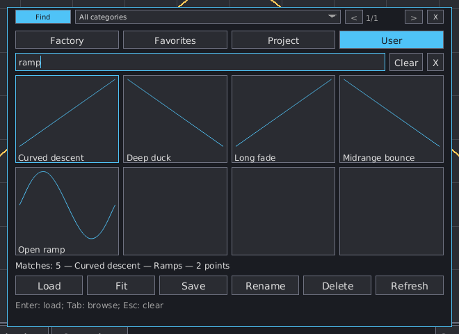

Cards, navigation, and recall actions follow the visible results. Empty results
disable record actions. Favorites and Project use their fixed slots.

The query supports 256 Unicode characters, printable Option input, Ctrl/Cmd+A,
Shift-selection, caret Left/Right/Home/End, Backspace and Delete. Once focused,
`/`, S/R/C and other characters enter text. Up/Down navigate result rows; Page
Up/Down page User results. **Enter** loads the selected match; **Shift+Enter**
fits it. **Tab** leaves typing focus for ordinary browser shortcuts/navigation.
Find or Ctrl/Cmd+F refocuses/selects the current query.

Clear empties the query and keeps typing focus. X or Escape closes and clears
search while retaining the category filter; another Escape closes the browser.
Category popups and metadata/Delete dialogs keep priority above search, so
Escape dismisses those first. Clicking another browser control leaves query
focus. Changing tabs, reopening, resizing, losing focus or replacing the authored
document discards the query and transient search interactions.

Refresh/Delete keep the query and clamp selection within remaining matches.
After Save/Rename, the browser follows the saved ID; if its new name/category
would hide it, the query clears to reveal it. Search changes no stored records,
library formats, curve undo/baking, frozen capture or audio behavior. Only
explicit recall edits the curve, using the established geometry-only rules.
Small windows that cannot fit the row and usable thumbnails show the enlargement
message before hidden input can act.

### Shape menu and files

Shapes includes eight factory curves: Flat high, Flat center, Ramp up, Ramp down,
Triangle, Sine, Square, and Duck. It also provides eight shared favorite slots:
**Store favorite N** replaces that slot; **Load favorite N** recalls it. Favorites
are saved in the platform's application-data directory and survive closing the
plugin. All four plugins use the same library.

**Copy curve** and **Paste curve** use a dedicated Tract curve clipboard, shared
through that directory between instances, plugin formats, and host processes.
They leave the system's text clipboard alone. Copy always captures the entire
curve. **Paste fitted to height** scales the incoming values to the current
curve's minimum/maximum; a flat incoming curve maps to that range's midpoint.

**Import shape...** and **Export curve...** open native file dialogs for versioned
JSON files. Library operations transfer point positions, levels, tension,
steps, native shapes, and weights. They preserve the destination's length, clock, play mode, grid,
polarity, routing, and modulation depth. Replacing a complete shape clears its
sustain/loop markers. Missing favorites, unavailable storage, invalid files, and
capacity errors appear beside the menus without replacing the curve.

Old projects and version-1 curve files load with Curve/Hard defaults and retain
their original sound. Legacy-only exports stay version 1. Native shapes or
non-Hard weights use version 2, which older builds reject. Use current plugin
builds for projects containing new node metadata; older project readers ignore
the added attributes and cannot reproduce those shapes.

### Copying and pasting a phrase

1. Select at least two adjacent points and choose **Edit → Copy selection**.
2. Select the destination interval.
3. Choose **Edit → Paste replace selection** to fit the phrase into that
   interval. Choose **Paste merge selection** to keep existing interior
   points too. If two points land at the same time, the pasted point wins.

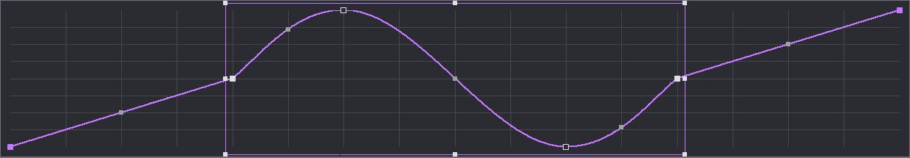

Copying a phrase retains its levels, tensions, steps, shapes, and interior
point weights. Its time is relative to the copied interval. Points outside
the interval and the outgoing segment after its last point are preserved.
Existing boundary points keep their outside-facing weights so adjoining
segments retain their styles. Full-curve replacement transfers every weight.
Both modes select the resulting interval and reject the entire operation if
it would exceed 128 points or create overlapping times.

## Precise points and navigation

Select one point and click **Point**, choose **Inspect point** from Edit, or press
**Ctrl/Cmd+Enter**. The shared effect editor shows the point's routed parameter
value or Amp dB beneath the fields.

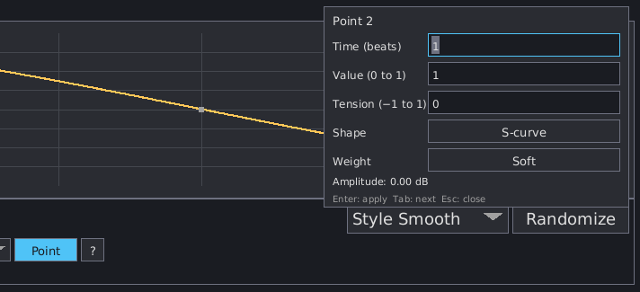

| Field | Valid entry | If blank when applied |
|---|---|---|
| **Time** | Strictly between the previous and next points. Enter beats in Beat mode, milliseconds in Time mode, or a percentage of the span in Miff/Nap. The endpoints stay at the start and end of the curve. | Midpoint between the neighbouring points. |
| **Value** | 0 to 1 for Unipolar or −1 to 1 for Bipolar. | 0 in the displayed range. This is the bottom in Unipolar and the centre in Bipolar. |
| **Tension** | −1 to 1 for the outgoing Curve or S-curve segment. Steps and the last point have no editable tension. | 0, the neutral tension for the selected shape. |

Focusing a field selects its contents for replacement. Enter applies that field;
Tab applies and moves to the next editable field (Shift+Tab moves back). Escape
closes and discards uncommitted text. Clicking outside applies the entry or its
blank-field default and closes. Invalid text keeps the inspector open and shows
an error. Right-click dismisses it. Exact numeric input bypasses the snap grid.

**Wheel** over the canvas zooms time around the pointer; **Shift+wheel** zooms
levels. **Middle-drag** pans. **View → Fit all** restores the full curve;
**Fit selection** frames selected points with a little padding. Zoom is limited
to 64x. Grids and snapping stay in document coordinates. Menus and the inspector
consume wheel input while open. Escape cancels an in-progress pan.
Pending dial/Mix/Output numeric input is finalized before panning starts;
Escape cancels the pan while keeping the committed parameter value.

Navigation does not alter the saved curve or create undo/bake work. Viewports
are retained across resizing in the current editor session. Nap's panes have
independent views, and its pulse field follows the Decay pane's view.

## Semitone grids

In Multosis/Minitosis, assign an envelope to a pitch parameter in `st` or a
logarithmic frequency parameter, set a nonzero Depth, and choose **Semitones**
from Grid. The control shows **T/st**, keeping the current number of time
divisions.

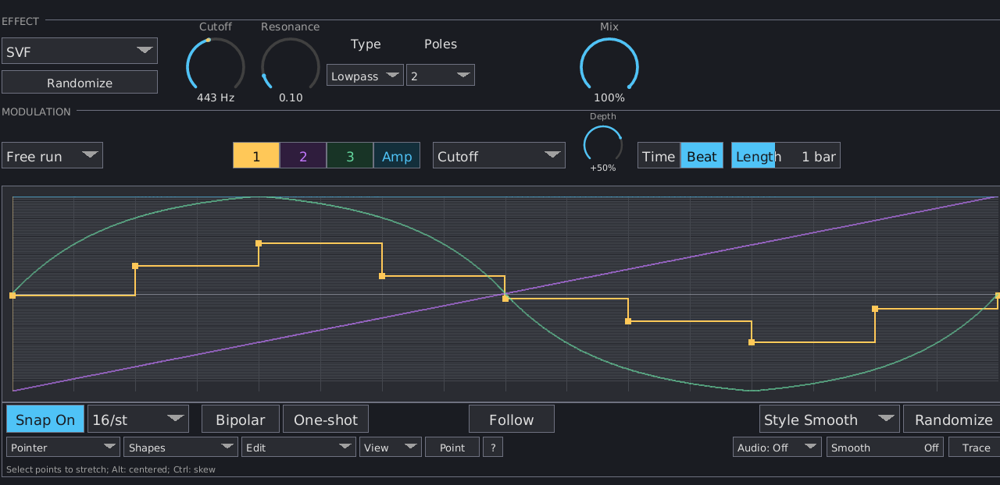

Choose a numeric grid preset to return to ordinary level divisions. Changing
the grid keeps the existing points in place. The mode saves per envelope and is
undoable.

The grid follows the routed parameter's base value, Depth, and polarity, including
negative depth. Pitch offsets use integer semitones; frequencies use chromatic
equal-tempered notes with A4 = 440 Hz. Only levels reachable through that routing
are available. Base/Depth/polarity changes refresh the lines while retaining the
existing curve, which may then have points off-grid.

With **Snap On**, drawing and dragging use those note levels. **Shift-drag**
allows fine off-grid levels. Group moves snap their anchor; selection transforms
snap their edited edge while retaining the group's geometry. Pens, stepped-draw
heights, mutation, and Randomize also use the musical grid. Closely spaced lines
may be thinned visually; all note levels remain available for snapping.

Use **Edit → Quantize points** to move selected points, or all points when none
are selected, onto the current time/note grid in one undo step. A time collision
rejects the entire edit. Exact numeric input and imported/pasted/factory shapes
retain their authored values. Curve and S-curve segments still glide between
their points; Step holds a note until the next point.

Amp, Mix, selectors, unsupported units, zero depth, and routes with no reachable
note have no musical grid. Choosing Semitones there leaves the curve/settings
intact and reports the unavailable grid. A previously selected mode shows
**st n/a** after such a routing change: time snapping continues, vertical
interactive snapping pauses, and Quantize leaves the entire curve intact.
Miff/Nap retain their numeric grids. Shape clipboard/files preserve the
destination's grid preference.

## Live smoothing and trace

Multosis/Minitosis provide **Smooth** and **Trace** at the lower right of the
curve pane. Smooth applies a lag to the selected envelope's output before
Depth and Target mapping. It works on Amp, Mix, continuous effect targets, and
unrouted envelopes. Selector targets show **n/a** and bypass smoothing while
retaining the saved time.

Smooth ranges from **Off** to **1000 ms**. Drag to adjust, Shift-drag for fine
adjustment, double-click to reset to Off, or right-click to enter milliseconds.
The time is the lag's time constant: after a step, roughly 63% of the change is
reached in that time. Settings are saved per envelope and are undoable. Shape
clipboard/files transfer geometry and leave Smooth unchanged. Old projects
default to Off, preserving their existing modulation behavior.

Positive Smooth keeps running during bypass and on inactive rows. Retriggers,
loop wraps, and transport restart retain the lag so they do not reset its level.
Explicit Reset clears it; a DSP flush clears it while preserving phase. Amp and
Mix update each sample; continuous effect targets update on a 1 kHz control
clock. Existing Free Hz and Transient triggers still align to processing blocks.

Trace is off by default. Turn it on to see where the measured envelope output
visibly differs from the drawn curve, for example when Smooth or an envelope
follower changes the source. The thin trace uses a lighter tint of the selected
curve's colour and draws beneath it. Trace measures
the source before Depth and Target mapping. Colored dial arcs show values
delivered to their destinations, including Mix transitions. Trace follows zoom
and pan, pauses during curve drags, and starts fresh after curve edits or when
switching envelopes, rows, effects, or active MIDI waves. It fills as audio is
processed and hides while Minitosis prepares a newly selected effect. The toggle
is a display preference.

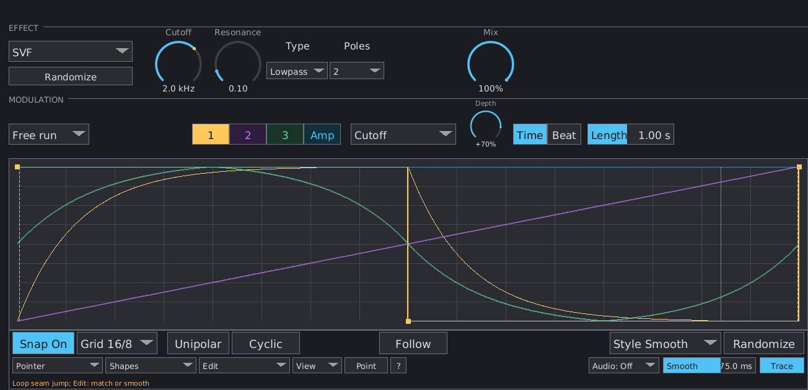

### Audio waveform backdrop

In Multosis/Minitosis, **Audio** beside Smooth/Trace offers **Off**, **Input**,
**Output**, **Input + Output**, and **Sidechain**. It draws stereo magnitude peaks
beneath the curve: input in gray, output in the selected envelope's color. The greater
absolute channel sets each peak. Full height is magnitude 1; louder signals
clip visually. The horizontal axis follows the selected envelope's clock,
including its triggers and loops. Zoom and pan apply to the backdrop too.

| Display | What to look for |
|---|---|
| **Magnitude** (default) | Peaks use the greater absolute level of either channel. |
| **Combined** | Left and right waveforms share a centre line. |
| **Stereo** | Left appears above right, each with its own centre line. |

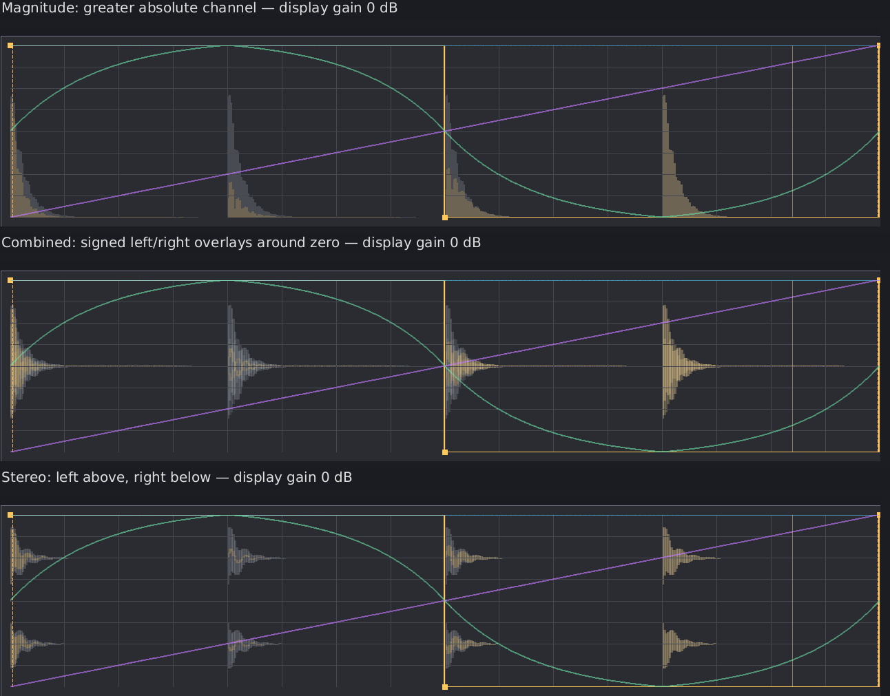

Opposite-polarity channels remain visible. Vertical zoom and pan scale the
signal within each fixed Stereo lane.

**Gain: -12 / 0 / +12 dB** adjusts only the backdrop's display level, useful for
quiet material. The default is 0 dB. Peaks clip at the display boundaries without
crossing Stereo lanes. Changing display mode or gain reuses the current capture,
including a frozen one, and leaves the sound, trace history, and undo unchanged.

Capture examines every audio sample and keeps the largest peak in each phase
bin, so short transients remain visible. Each pass updates the bins it visits;
the remaining bins retain their last observed values. **Freeze** stops capture
and retains the current display for editing. **Unfreeze** starts fresh. Switching
between Input/Output/Both keeps the captured data; Off clears it. Freeze survives
focus changes and resizing. Switching envelope, row, effect, or restored state
clears the history, including a frozen display.

Sidechain displays the raw auxiliary input, independently of the detector's
Input choice. It supports the same display modes and gain, and appears as **SC**
in the closed Audio control. Switching between Sidechain and the main
Input/Output/Both views clears the capture and unfreezes it to collect the chosen
source. Display mode/gain changes keep a frozen sidechain capture intact.

Multosis measures immediately before/after the selected row, including its Mix
and Amp, before the wet-bus compressor and master blend. Inactive, muted, and None
rows pass the same signal to both layers, including processing by preceding
rows. Minitosis measures processor input and returned output before Output gain;
bypass and effect latency remain visible. No display alignment changes the audio.

Audio/Freeze are editor-session preferences. They do not alter curves, saved
project state, host automation, or undo history. Capture stops when the effect
view closes, Audio is Off, or Freeze is active. Miff/Nap retain their static views.

## MIDI retriggering

Multosis/Minitosis accept MIDI note input. Route MIDI from your DAW to the plugin
and choose **Trigger → MIDI note**. Open **Note** to choose **Any** or search by
pitch name or MIDI number, such as `C4` or `(60)`. The menu uses C4 (60) for
middle C. Compare MIDI numbers if your DAW displays a different octave. **Ch.**
selects Any or channel 1–16. Filters are saved per row/effect and participate in
local undo.

Each matching positive-velocity note-on restarts all four envelopes on that row
at the host's note offset. Multiple notes within a block are retained. Other
rows continue on their existing clocks. Smooth Off retains endpoint evaluation;
positive Smooth retains its current level through the phase restart. An ongoing
Mix transition continues from the blend actually reached, without jumping ahead.

This source retriggers; it does not gate audio or follow note-off. Cyclic and
One-shot playback, sustain/loop markers, and envelope lengths keep their existing
rules. Zero-velocity note-ons, note-offs, and other MIDI messages do not retrigger.
Muted/inactive/None rows and Minitosis bypass still receive matching triggers.
Minitosis uses each effect's recalled filters as prepared processors are adopted.

## MIDI wave switching

In Multosis and Minitosis, **Waves...** beside **Cyclic / One-shot** chooses
which geometry a curve plays. It uses the eight slots on the Curve Browser's
**Project** tab. The stored waves share the timing and modulation routing of the
curve that plays them. The same button may read **MIDI on**, **MIDI P1–P8**,
or **Wave P1–P8**, depending on the current selection.

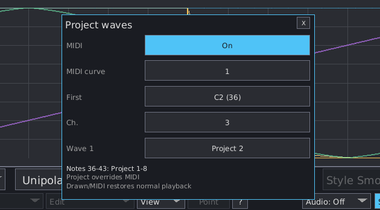

### Play a stored Project wave

1. With the shape you want on the canvas, open **Shapes → Browse shapes... →
   Project**. Select slot **1** and click **Store**.
2. Select MSEG **1** and open **Waves...**. Choose **Project 1** in the **Wave 1**
   field. The canvas previews that slot and geometry editing pauses.
3. To edit the drawn curve again, choose **Drawn/MIDI**. If MIDI switching is
   enabled for that curve, switch **MIDI** to **Off** as well.

The **Wave 1** field is also a host automation parameter. **Project 1–8** takes
priority over the MIDI mapping on that curve. [Wave automation](#wave-automation)

### Switch among Project waves with MIDI

1. Store the shapes you want to switch between in Project slots and route MIDI
   to the plugin. Select the envelope to switch, for example MSEG **1**.
2. Open **Waves...** and set **Wave 1** to **Drawn/MIDI**. Turn **MIDI** on and
   set **MIDI curve** to **1**.
3. Choose **First** and **Ch.**. With **First** at **C2 (36)**, note 36 chooses
   Project 1 and the next seven semitones choose Project 2–8. For example,
   **D2 (38)** chooses Project 3. Choose **Any** to accept all MIDI channels.

### Waves panel reference

| Field | What it controls |
|---|---|
| **MIDI** | Switches live MIDI wave selection on or off. |
| **MIDI curve** | One of Amp, 1, 2, or 3 to switch with notes. Each row or effect has its own mapping. |
| **First** | Lowest note in the mapping, MIDI 0–120. The range spans eight consecutive notes. Search by name or number. |
| **Ch.** | MIDI channel for wave switching, Any or 1–16. |
| **Wave Amp/1/2/3** | Geometry choice for the currently selected tab. **Drawn/MIDI** follows the drawn or MIDI-selected wave. **Project 1–8** picks a specific slot. |

The MIDI mapping saves with the project and participates in local curve undo.

Positive note-ons switch at their host sample offsets. Empty slots, note-offs,
zero-velocity notes and notes outside the range/channel leave the playing wave
unchanged. Same-offset notes retain their order; the last valid selection wins.
The bottom-strip **Waves...** button shows the active slot, such as **MIDI P3**.

Switching preserves phase, smoothing and the other curves' clocks. The existing
**Trigger** setting remains independent: if a note also matches MIDI retriggering,
the newly selected wave starts after that reset. For one-shot curves already at
the end, use retriggering when you want a new note to restart playback.
The mapped curve ignores hold markers for the entire enabled mode; saved
sustain/loop markers return when switching is disabled.

The graph displays the playing wave with geometry tools dimmed and its points
hidden. Turn switching Off to edit the original authored curve. View zoom/pan,
Help, timing/polarity controls, other curves and effect controls remain available.
MIDI selections leave the saved authored curve, Project slots and undo history
intact. Identical wave copies keep the same smoothing/control-clock behavior.

Before the first matching note, the authored geometry plays. Changing/disabling
the mapping restores it; clearing an active slot also falls back to it. Editing
an occupied Project slot refreshes playback at a processing-block edge. Reset
clears the runtime selection; transport retrigger retains it. Presets save the
bank and mapping, with playback selection established by subsequent MIDI notes.
No extra trigger buffering is added; modulated effects retain their own latency.

Use Tab or Up/Down to choose a setup field, Left/Right to change its value,
and Enter/Space to toggle or open its selector. Escape closes a selector before
closing setup. Outside or right
clicks, focus loss and resize dismiss it without acting on controls beneath it.

## Envelope follower

The envelope follower turns the level of incoming audio into a control signal.
In Multosis and Minitosis, a row or effect has one linked stereo follower.
Each curve can use that shared signal in a different way. Use **Follow** beside
**Waves...** to adjust the selected curve and the shared response.

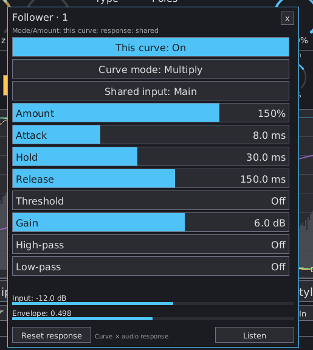

### Duck with a sidechain

1. Route a kick or other trigger sound into the plugin's external sidechain.
   Select **Amp** and load **Shapes → Flat high** for a full-level curve.
2. Open **Follow**. Turn **This curve** on, choose **Add** for **Curve mode**,
   and set **Amount** to −100%. At this setting, the follower subtracts from
   Amp as the sidechain gets louder.
3. Set the shared **Input** to **Sidechain**. Play the sidechain and check that
   the Input and Envelope meters respond. Use **Listen** to hear the filtered
   detector input if needed. [Sidechain routing](#external-sidechain)
4. Start with **Attack** at 5 ms, **Hold** at 0 ms, and **Release** at 100 ms.
   Lower Attack for a quicker drop or raise Release for a slower return.
   Turn on **Trace** to see the measured dip below the flat Amp curve.

In Minitosis, Amp ducks the wet contribution to Mix. In Multosis, Amp ducks
the output of the row after its Mix blend.

### Follower control reference

**This curve**, **Curve mode**, and **Amount** apply to the selected Amp, 1, 2,
or 3 tab. With **This curve** enabled, the three modes combine the follower and
curve as follows.

- **Follow:** Amount × envelope replaces the drawn source.
- **Add:** curve + Amount × envelope; negative Amount subtracts the envelope.
- **Multiply:** curve × Amount × envelope.

Results clamp to 0–1 before Smooth and the existing polarity/Depth/Target mapping.
Amount is 0–200%, or -200–200% for Add. Curve geometry stays editable and its
clock keeps running, even when Follow replaces its source. For ducking Amp,
use a flat-high curve with Add and negative Amount. Project/MIDI waves and DAW
position continue controlling the underlying curve normally.

The **shared response** applies to every enabled route on that row/effect:

- **Input:** original Main audio or external Sidechain. Stereo uses the larger
  absolute channel level after separate filters, so antiphase signals still work.
  A missing sidechain is silent.
- **High-pass/Low-pass:** Off or 20–20000 Hz, affecting detection only.
- **Gain:** -24–+24 dB before threshold/envelope detection.
- **Threshold:** Off or -60–0 dB. Quiet input feeds zero; Hold/Release still finish.
- **Attack/Hold/Release:** 0–1000/2000/5000 ms, default 5/0/100. Attack/Release
  are time constants; zero is instant. Hold delays decay after the input falls.

**Reset response** restores all shared settings, including Input and filters,
while preserving every curve's enable/mode/amount. Settings save with the project
and use local modulation undo. They do not add host automation parameters.

The **Input** meter shows the filtered and gained signal level at the detector.
The **Envelope** meter shows the shared result after the response timing. The
thin trace shows the combined source for the selected curve, and the dial arcs
show the delivered target values. Audio backdrops show raw waveforms. Frozen captures stay
available while adjusting the follower. Enum destinations bypass Smooth lag but
still use the follower's response. Effect parameters retain their 1 kHz control
cadence; Amp and Mix update each sample.

Scroll the panel or use Tab/Up/Down to reach fields; Home/End and Page Up/Down
move focus and scroll it into view. Left/Right adjust values; Enter/Space opens
a selector or numeric field. Right-click sliders to type; Enter commits and
Escape cancels a field before closing the panel. Outside presses, drag starts
and focus loss commit numeric input. Shift-drag is fine; double-click restores
the field default. No follower history is lost on retriggers or ordinary DSP
flushes. Explicit modulation Reset starts a fresh envelope. The feature adds no
latency and is Off in legacy presets. Miff/Nap keep static curve editing.

## Detector input audition

Multosis/Minitosis provide **Listen** in both **Detect...** and **Follow** panels.
Click it, or press **L** with no numeric edit, dropdown or drag active, to hear
that panel's filtered Main or Sidechain input. Click/press again to return to
normal processing. Output gain still applies.

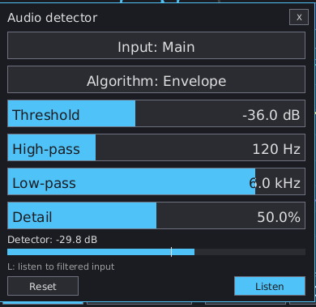

The trigger detector monitors its mono sum through High-pass/Low-pass. The
follower monitors stereo through its filters and shared Gain; routes can remain
Off. Threshold, Attack/Hold/Release and curve amounts do not shape the preview.
The preview is limited to +/-1 before Output gain. Filters have their own monitor
history, so listening does not change trigger timing or the running effect.

Listen replaces the processed output after Mix/compression, with a short fade.
It follows the plugin's reported latency; normal audio plays while the monitor
delay fills after enabling or changing its input/latency. Minitosis bypass and
pending effect preparation return ordinary dry audio. Multosis can monitor a
muted/inactive/None row because the detectors use original main/aux audio.

Closing/dismissing the panel, losing focus, resizing, selecting another row/effect,
loading a preset, resetting DSP, or closing the editor stops Listen. It is not
saved or automated and adds no undo step. Filter/Gain edits keep it active as the
audio thread adopts them; stopped requests need explicit re-enabling. Frozen
waveforms, traces and ordinary effect state remain available throughout.

## MIDI pitch playback

In Multosis/Minitosis choose **Trigger → MIDI pitch** to clock all four curves
from MIDI notes. A matching note-on sets the full 0–1 phase rate to that note's
frequency and restarts at phase zero on the note's exact sample. **Semi** selects
-36..+36 semitones of transpose; **Ch.** selects Any or MIDI channel 1–16. The
last matching note wins, including simultaneous notes in host order. Note-off
keeps that rate running; velocity-zero notes and pitch bend do not affect it.

Before the first note, phases wait at zero. Changing Channel clears the latched
note and waits again. Changing Semi retunes the last note without restarting.
The old Time/Beat controls show the measured note and Hz/kHz, **Waiting**, or
**No data** when there is no matching measurement yet. Saved Time/Beat lengths
return when leaving MIDI pitch; they do not change its rate or tempo response.

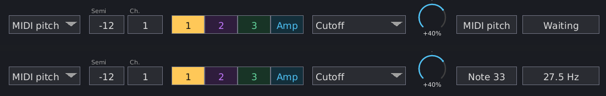

Cyclic, OneShot and hold markers retain their traversal behavior. A shorter
hold loop naturally repeats faster than the full-curve Hz rate. Every new note
restarts a completed OneShot. MIDI/Project waves and envelope-follower routes
can be used together; a note can switch a wave and set pitch at the same time.
Smooth retains its level across notes; Amp and Mix update per sample while
effect parameters retain the fixed 1 kHz control cadence.

The waveform and thin trace follow actual pitch phases. Waiting pauses audio
capture; frozen captures stay available. Retrigger on play keeps the last note
and restarts phase. Ordinary DSP flush and same-effect sample-rate changes keep
pitch and phase; a different effect kind waits for a fresh note. Explicit
modulation Reset clears the pitch. Settings save per row/effect and use local
modulation undo; there are no additional host parameter IDs or latency.

## DAW-position playback

Choose **Trigger → DAW position** in Multosis/Minitosis to follow the song
timeline. Every curve keeps its own length: **Beat** divides the host's quarter
note position by its beat length; **Time** uses song seconds and its time length.
The first sample plays the supplied position, including after a seek or restart.
Active host loops also wrap within a processing block when their ranges are known.

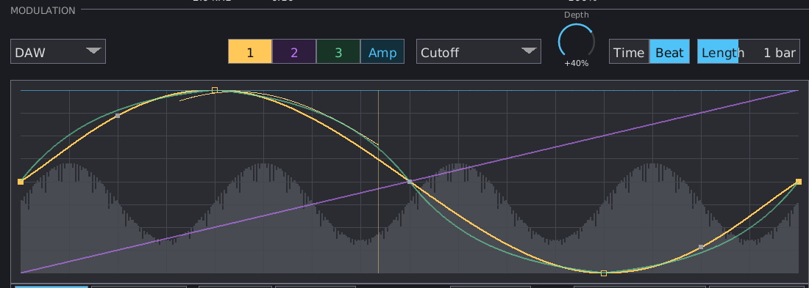

**Cyclic** repeats across the timeline, including negative pre-roll positions.
**OneShot** starts at timeline zero and stops at its endpoint or sustain marker.
Hold loops keep their normal behavior: cyclic loops use their existing wrapped
phase, while one-shot loops play the intro before repeating the marked region.
Reset/Retrig cannot move a DAW-driven playhead away from the song position.

While stopped, phase stays at the reported cursor; moving that cursor relocates
the curves. Missing positions freeze only the affected clock. Beat needs a valid
tempo to advance between reported positions; Time can advance without tempo.
Host-supplied timing determines precision. If a host only supplies beats, derived
seconds use its current tempo: choose Beat for reliable timing through tempo changes.

Smooth Off updates the source, Amp and Mix per sample. Positive Smooth keeps its
lag across seeks; effect parameters retain their fixed 1 kHz control cadence and
refresh immediately at discontinuities. Selector targets bypass source lag.
The playhead, measured trace and waveform capture use the same phase; stopped or
unavailable clocks pause capture. Curve geometry and timing remain editable.

Project Wave automation and MIDI wave selection keep working with their existing
priority. They change geometry while the DAW clock continues. Other retrigger
sources do not override DAW position. Leaving this mode resumes free playback
from the last phase. The mode saves per row/effect; old presets remain unchanged.

## Wave automation

Multosis exposes **Amp Wave**, **1 Wave**, **2 Wave** and **3 Wave** host
automation parameters for each fixed row. Minitosis has an independent set for
every effect. These are stepped selectors: **Drawn/MIDI** (default) or **Project
1–8**. To set one from the editor, choose the curve, open **Waves...**, and use
the **Wave Amp/1/2/3** field. These edits use host parameter gestures and host
undo; local curve undo keeps the authored geometry separate.

A selected Project slot takes priority over MIDI for that curve. MIDI keeps
tracking notes underneath, so returning to Drawn/MIDI resumes its latest wave,
or the drawn curve when no MIDI selection exists. An empty Project slot plays
the drawn geometry while continuing to override MIDI. Editing, populating or
clearing the slot refreshes playback when the bank is next available to audio.

Switching preserves phase and source smoothing and follows host automation
sample boundaries. The graph shows the playing shape with geometry editing
paused; the strip shows **Wave P1–P8**. Hold markers are ignored during Project
playback. Choose Drawn/MIDI and turn MIDI Off to restore normal geometry editing
and saved hold markers. View/Help and timing/routing controls remain available.

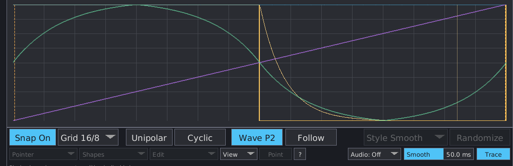

Wave values and the Project bank save with host state; older presets default
to Drawn/MIDI. Reset reapplies host Wave values while clearing runtime MIDI
selection; transport retrigger retains both. Multosis Wave lanes remain attached
to their row numbers when rows move. Miff/Nap retain manual Project recall.

## Sample-timed Hz and audio triggers

### Free Hz and Free Hz (sample)

Both trigger modes restart all four envelopes on the row or effect at the
**Rate** setting of 0.05–20 Hz, independently of DAW tempo. At **5 Hz**, the
restart interval is 200 ms. **Time/Beat** and **Length** still set how quickly
each curve moves between its points.

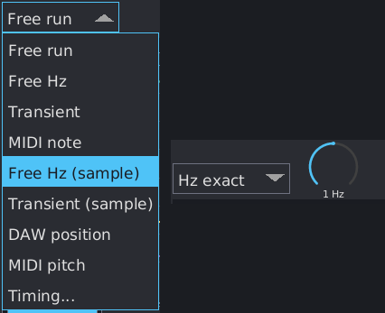

| Trigger mode | When it restarts | When to choose it |
|---|---|---|
| **Free Hz** | At the start of a host audio buffer, when the time accumulated through that buffer reaches the interval. It can fire once per buffer. The host buffer size affects the timing. | To recall a setup made with the original Free Hz timing. |
| **Free Hz (sample)** | On the sample where the interval comes due, even inside a buffer. A long buffer can contain several restarts. The closed button reads **Hz exact**. | For new rhythmic cuts or other modulation that needs consistent restart timing across buffer sizes. |

For example, at 48 kHz with 512-sample buffers, a 5 Hz clock first comes due
at sample 9,600. That falls inside the buffer starting at sample 9,216.
**Free Hz** restarts at that buffer's start. **Free Hz (sample)** restarts at
sample 9,600.

Free Hz (sample) keeps its clock across buffers, grid steps, and other rows'
MIDI notes. The first restart follows a full period. Rate edits retain clock
progress.

### Transient (sample)

The closed button reads **Audio**. The **Detect...** button sits just above it,
with **Sens** and **Hold** to the right.

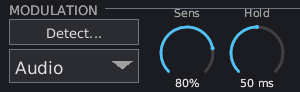

Transient (sample) uses the same dual-envelope detection
and Hold rules as Transient, but restarts on each qualifying sample, including
multiple detections in one buffer. By default it listens to the plugin's original
dry stereo-average input, before any row's effects; Detect can select the external
Sidechain instead. Detector attack/release and the noise floor still apply.
Lookahead defaults Off, so these modes add no latency until it is enabled.

Only the triggered row restarts. Other rows keep their held values and clocks.
Smooth retains its level through the restart; Off keeps endpoint evaluation.
Inactive/muted/None rows and bypass continue detecting. Reset and transport
restart clear the private trigger clock; a DSP flush preserves it. Sample-rate
changes retain progress/refractory time, including same-effect Minitosis
reinitialization. Mode/rate/Sens/Hold settings save per row/effect and are undoable.

### Trigger timing

Choose **Trigger → Timing...** in Multosis/Minitosis to open timing controls
without changing the current trigger source. Settings save per row/effect and
add no host automation parameters. Lookahead, Audio shift and Retrigger blend
default Off; only enabled audio lookahead adds reported latency.

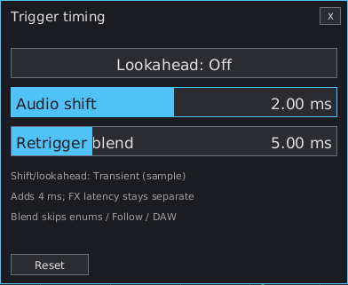

- **Audio shift (0–4 ms, or -4–+4 ms with Lookahead):** offsets phase resets from
  Transient (sample), rounded to the nearest sample. The detector and its
  Threshold/Hold/meter keep their original timing. Accepted hits can queue across
  blocks. Shift alone leaves the audio path unchanged; enabling Lookahead adds
  the input delay described below. Other trigger sources and MIDI wave switches
  keep their original offsets.
- **Retrigger blend (0–20 ms):** fades from the last delivered source value into
  the newly running curve after a phase reset. It follows follower combination
  and Smooth, before polarity/Depth/Target mapping. New resets during a blend
  start from the value currently being delivered. Follow-only follower routes,
  enum destinations and absolute DAW-position playback bypass this blend.

Blend applies to explicit MIDI/cell/free-Hz/audio/transport resets; ordinary
loop wraps and wave replacements retain their existing behavior. Enabling timing
or lookahead opts into per-sample source playback, including phase zero on a
reset sample.
Amp and Mix update each sample; effect parameters retain their fixed 1 kHz
control cadence plus immediate reset refresh. With all timing preferences Off,
playback keeps its original behavior.

Shift edits affect future detections; already queued resets retain their accepted
timing. Turning Shift Off with no lookahead path, changing trigger mode/input,
Reset or transport restart clears queued resets. Positive Blend edits affect
later cues; Off cancels the current blend. Sample-rate adoption retains/rescales pending
timing. Inactive/muted rows, bypass, Listen and frozen captures keep their normal
roles. Negative shifts use the delayed audio described below.

Drag or Shift-drag for fine control; double-click restores zero. Right-click to
type milliseconds or `Off`. Enter commits; Escape cancels a field before closing
the dialog. Outside press, another drag and focus loss commit numeric input.
Tab/Shift-Tab or Up/Down moves focus; Left/Right adjusts, Enter edits, and
Home/End selects the first field or Reset. **Reset** restores all timing
preferences Off in one undo step. Resize/source/preset replacement discards
stale interaction; windows too small for readable controls show an enlargement
message.

### Lookahead and negative shifts

**Lookahead: 4 ms** in Timing... is effective for **Transient (sample)** only.
It delays that row/effect's input by 4 ms rounded up to samples, while detection
still reads live original Main/Sidechain. **Audio shift** can then be -4..+4 ms.
A negative shift moves resets earlier relative to the detector's cue on the
delayed input; zero retains alignment against the added lookahead. Detection
itself still follows the selected algorithm's causal response.

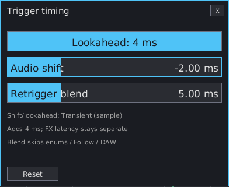

Existing effect/FFT latency keeps its prior relationship to modulation and is
separate from this shift. MIDI/free/DAW clocks and wave-note offsets retain their
normal processing-time definitions, as with other latency-adding effects.

Minitosis aligns dry, Mix and bypass to effect latency plus lookahead. Multosis
adds the windows of unmuted lookahead rows, including inactive/None rows, so grid
activity does not change its lookahead latency. Its global dry Mix receives the
same added delay. Mute/Solo exclusions bypass a row's window; downstream audio
triggers compensate for the remaining upstream windows. The host receives the
added latency for PDC. Other effect-latency behavior remains unchanged.

While lookahead is active, Multosis reports its full declared latency as a finite
tail, including when rows are inactive/None or global Mix is zero. This protects
queued audio and Listen during silent callbacks. CLAP continues processing while
lookahead is enabled; disabling or bypassing all windows restores the normal
suspension policy.

Row DSP and Input/Output capture use the delayed series input/result. Followers
read original Main/aux delayed to that row's lookahead path; Sidechain capture
uses the delayed original aux. Listen retains its independent filters and aligns
to total reported latency. Path changes discard old queued audio/cues and warm with zeros; they
stop an old Listen request. Live capture starts a new aggregation without
discarding frozen views. Buffers are reserved during setup, outside processing.

Toggle Lookahead with a click or keyboard focus/Enter. Pending numeric input
commits first. Turning it Off clamps a negative shift to zero; Reset restores
Lookahead, Shift and Blend Off together. The preference saves per row/effect and
uses local undo. Ordinary empty callbacks defer path/latency adoption; explicit
transport restart retains its reset exception.

### Audio detector setup

With **Transient (sample)** selected, click **Detect...** above the trigger menu.
The panel provides **Input: Main / Sidechain**, **Algorithm**, **Detail**,
**Threshold**, **High-pass**, and **Low-pass**. Input defaults to Main,
Algorithm to Envelope, Detail to 50%, and threshold/filters to Off. Older
projects and the other trigger modes keep their existing behavior.

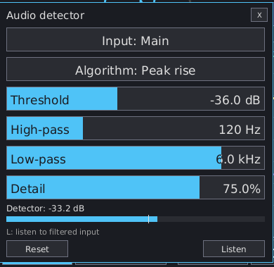

- **Envelope:** the original fast/slow rectified-envelope detector. At Detail
  50%, its attack/release windows remain 0.5/5 ms (fast) and 30/200 ms (slow).
- **Peak rise:** compares each absolute sample with the previous decaying peak
  reference. Its reference decays over 20 ms at Detail 50%; it suits distinct hits.
- **RMS rise:** compares fast and slow averaged energy as RMS amplitudes, with
  2 ms and 200 ms windows at Detail 50%. It responds to energy increases.

**Detail** changes window duration: 0% is four times longer, 50% uses the
listed windows, and 100% is four times shorter. Higher Detail responds faster;
Sens still sets the required rise ratio and Hold still sets the minimum gap
between triggers. The modes analyze causally at the input sample rate and add
no lookahead or reported latency. Detection can follow the physical onset as
the analysis windows fill.

Threshold is Off or -60..0 dB, tested against the displayed algorithm level:
fast envelope, current peak, or fast RMS, after filtering. Quiet rejected
candidates do not start Hold, so a louder hit can still retrigger when it
qualifies. Algorithm changes clear analysis history but keep remaining Hold;
Detail edits preserve both. Listen's input filters/history stay independent.

The filters are causal one-pole (6 dB/octave) stages, each independently Off or
20..20000 Hz. Use High-pass to reduce bass-triggered restarts or Low-pass to
reduce high-frequency triggers. Both may be enabled, including crossed cutoffs.
They affect detection only. The live meter shows the actual prepared detector
level with a threshold marker; Input/Output backdrops keep their normal signal
views. Missing or stale Algorithm/Detail measurements show **Waiting for audio**.

Drag to adjust, Shift-drag for fine control, double-click for Off, or right-click
to enter a value such as `Off`, `-24 dB`, `200 Hz`, or `5 kHz`. Detail uses percent
entry, such as `75%`, and double-click resets it to 50%. Numeric input is
committed before another slider drag or outside click. Escape first cancels an
active field, then closes the panel. Algorithm menus support arrows, Home/End,
wheel, Enter and Escape. **Reset** restores Envelope/50% and all three Off in one
undo step while retaining the selected Input. Settings save per row/effect, but shape
clipboard/files do not transfer them.
Focus loss, resize, and native window close finalize edits; binding replacements
discard old numeric buffers so they cannot apply to another row/effect.
If the window cannot fit readable controls, the panel asks you to enlarge it;
its parameter controls and Listen are inactive until there is enough room.

### External sidechain

Multosis/Minitosis expose a stereo auxiliary input named **Sidechain**. Route a
source track to that input in your DAW, choose **Transient (sample)**, open
**Detect...**, and click Input to select Sidechain. The source's stereo average
feeds the threshold and filters; the meter shows the resulting detector level.
Missing auxiliary data is silence, so an unconnected Sidechain does not trigger
from main audio. Mono auxiliary buffers are duplicated; short buffers use silence
for the missing samples.

Changing Input commits pending numeric text and clears detector/filter/Hold
history while the envelopes keep their phase. The choice saves per row/effect
and is undoable. Sidechain audio feeds detection and display only; the audible
signal remains the main input/effect path, with unchanged latency. The legacy
Transient source retains its main-input, block-aligned behavior.

Use **Audio → Sidechain** to align curves against the unfiltered source. This
view is independent of Detect's Input choice. A stereo-only layout also remains
available for hosts choosing the previous audio configuration.

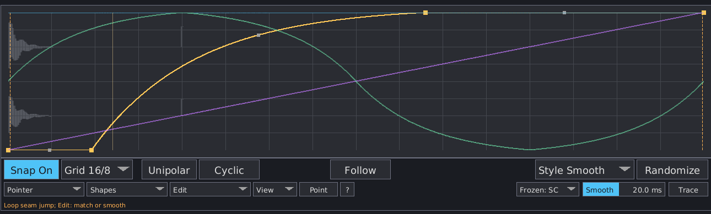

## Edit commands

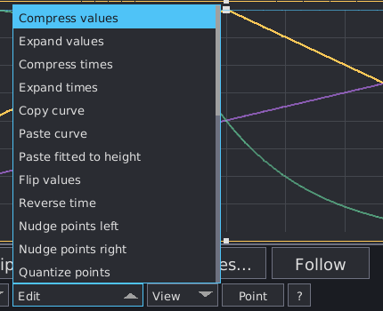

- **Compress/Expand values/times** retain their existing behavior and require a
  selection. Each invocation scales the selected axis by 0.75 or 1.25 around
  its mean.
- **Flip values** inverts selected levels, or the entire curve if nothing is
  selected.
- **Reverse time** reflects a contiguous selection, or the entire curve.
  Curvature reverses with it. Reversed stepped segments use a short linear
  transition to retain the original held level.
- **Nudge points left/right** moves selected interior points one time-grid cell,
  constrained by neighbors. With no selection it moves all interior points.
- **Quantize points** snaps selected points, or all points, to the current
  time/value grids. If times would coincide, the command leaves the curve intact.
- **Repeat 2x/3x** fits two or three copies into the same time span. It requires
  a contiguous selection, or operates on the full curve when nothing is selected.
- **Mutate values** varies existing selected levels, preserving rhythm and point
  count. **Mutate shape** also varies time and curvature while retaining the
  selection's time boundaries. With no selection, either mutates the full curve.
  The existing Randomize button still generates a fresh curve in its chosen style.

Curves remain limited to 128 points. Operations that would exceed that limit
or overlap points are rejected as a whole. The grid menu adds **6 / 8**,
**12 / 8**, and **24 / 16** for triplet subdivisions.

## Keyboard and history

| Shortcut | Action |
|---|---|
| Ctrl/Cmd+A | Select all points |
| Ctrl/Cmd+C | Copy curve |
| Ctrl/Cmd+V | Paste curve |
| Ctrl/Cmd+Shift+V | Paste fitted to height |
| Ctrl/Cmd+Alt+C | Copy selection |
| Ctrl/Cmd+Alt+V | Paste replace selection |
| Ctrl/Cmd+Alt+Shift+V | Paste merge selection |
| Ctrl/Cmd+Enter | Inspect selected point |
| Wheel / Shift+wheel | Zoom time / values |
| Middle-drag | Pan the view |
| Left / Right | Nudge selected interior points by one time-grid cell |
| Shift+Left / Right | Nudge by 1/16 of a cell |
| Delete / Backspace | Delete selected interior points |
| Escape | Close a menu or cancel a curve gesture |
| Ctrl/Cmd+Z | Undo in Multosis or Minitosis |
| Ctrl/Cmd+Shift+Z or Ctrl/Cmd+Y | Redo in Multosis or Minitosis |

Menus accept arrows, Home/End, Page Up/Down, Enter, Escape, and wheel scrolling.
Active text fields retain keyboard priority. Multosis/Minitosis record each
curve gesture or command as one undo step. Miff rebakes on changes. Nap defers
Efficient-engine IR baking during a gesture and bakes on release.

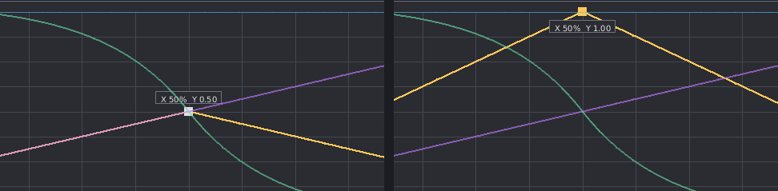
