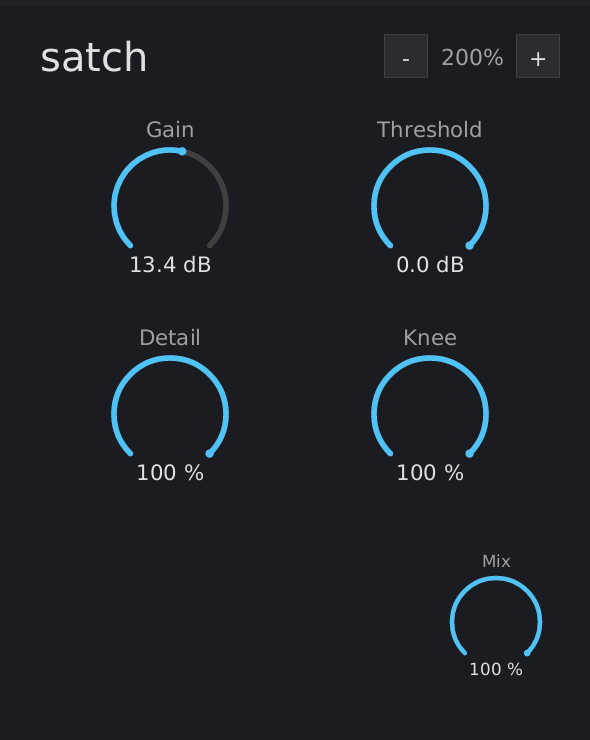

# satch Manual

{ width=50% }

## What is satch?

satch is a detail-preserving spectral saturator. It uses FFT-based spectral analysis to preserve quiet frequency components (detail) through the clipping process, leaving room beneath the output ceiling for small variations that ordinary clipping would remove.

Inspired by Newfangled Audio's Saturate.

## Installation

Build from source (requires stable Rust):

```bash
cargo nih-plug bundle satch --release
```

The bundler outputs to `target/bundled/`. Copy either the `.vst3` or `.clap` file to your plugin directory:

- **Linux**: `~/.vst3/` or `~/.clap/`
- **macOS**: `~/Library/Audio/Plug-Ins/VST3/` or `~/Library/Audio/Plug-Ins/CLAP/`
- **Windows**: `C:\Program Files\Common Files\VST3\` or `C:\Program Files\Common Files\CLAP\`

## Quick Start

1. Insert satch on a track
2. Raise **Gain** to push the signal into clipping
3. Turn up **Detail** to preserve quiet harmonics through the clipped sections
4. Adjust **Knee** to taste (0% = hard clip, 100% = soft tanh)

## Controls

### Row 1: Level

#### Gain

Input gain boost. Range: 0 to +24 dB. Default: 0 dB.

Pushes the signal toward the clip ceiling. Higher gain = more of the signal exceeds the threshold and gets clipped. At 0 dB, the signal passes through at its original level (clipping only occurs if it already exceeds the threshold).

#### Threshold

Clip ceiling. Range: -24 to 0 dB. Default: 0 dB.

Sets where clipping begins. At 0 dB, the ceiling is at full scale (±1.0). At -6 dB, the ceiling drops to ±0.5 -- any signal above that level is clipped. Below the threshold, the signal passes through unchanged.

Threshold is independent of Gain. Gain controls how hard the signal hits the ceiling; Threshold controls where the ceiling is.

### Row 2: Character

#### Detail

Spectral detail preservation. Range: 0 to 100%. Default: 0%.

Controls how much quiet spectral content survives through the clipping process.

- **0%**: Standard time-domain saturation. Flat tops are smooth and featureless -- all frequency content in the clipped region is destroyed.
- **100%**: Maximum detail preservation. The dominant waveform is clipped at a lower internal level so quiet components can oscillate above and below it, with their peaks reaching the output ceiling. At extreme settings, detail is scaled to fit the available headroom.

Below the Threshold, changing Detail leaves the ordinary Knee-shaped output unchanged. Preservation engages smoothly above the Threshold and reaches full strength when the gained input reaches twice the Threshold (about 6 dB above it). Gain boosts both the dominant signal and the protected detail.

The spectral analysis uses a 2048-point FFT with 75% overlap (512-sample hop), introducing 2048 samples of latency (compensated automatically by the host).

#### Knee

Clipping shape. Range: 0 to 100%. Default: 100%.

Controls the transition from linear to clipped:

- **0% (hard)**: Brick-wall clipping. The signal passes through linearly below the threshold and is hard-clamped at the threshold. Sharp transition, maximum edge.
- **100% (soft)**: Tanh saturation curve. Gradual transition into clipping -- signals approaching the threshold are gently compressed before reaching the ceiling. Warmer, rounder character.
- **In between**: Linear crossfade between hard and soft.

### Bottom Right

#### Mix

Dry/wet blend. Range: 0 to 100%. Default: 100%.

At 100%, the output is fully processed. At 0%, the output is the original dry signal (delayed to match latency). Use intermediate values for parallel saturation.

## How It Works

satch uses spectral separation to protect quiet components from the waveshaper:

1. A 2048-point STFT identifies quiet bins relative to the frame's strongest bin: bins within about 6 dB of the peak stay in the dominant path, bins more than 20 dB below it enter the quiet path, with a crossfade between.
2. An inverse STFT reconstructs the quiet waveform. Recent peaks of that waveform reserve headroom for at least one FFT window (about 43 ms at 48 kHz). The internal clip line stays steady across sustained detail; when older peaks expire, the reservation releases smoothly toward the current recent peak. With no new quiet content, an isolated old reservation decays by about 98% over another FFT window.
3. The protected fraction of the quiet signal is removed from the gained input before waveshaping. The internal clipping level is lowered by the reserved headroom, and the protected signal is added back once. **Threshold remains the final output ceiling.**
4. A smooth blend introduces preservation above the Threshold; below it, the ordinary time-domain waveshaper is used exactly.

The wet signal stays within ±Threshold. Headroom is limited to half the ordinary shaped output magnitude, never more than half the ceiling, so restored detail cannot reverse the polarity of a strongly clipped lobe. When the held detail peak exceeds that budget, the quiet waveform is scaled to fit; it is not individually hard-clipped.

A newly larger detail peak increases the reservation immediately to protect the ceiling. This can move the internal line at the first onset; sustained detail retains its original positive and negative excursions, including any natural asymmetry.

The spectral split identifies quiet frequency bins, not separate instruments. Its ability to separate a quiet component from a nearby loud one is limited by the FFT resolution.

## Scaling

The window is freely resizable -- drag the plugin window's edge or corner in your host. (There are no in-plugin zoom buttons or keyboard shortcuts.) The scale tracks the window width and clamps to 0.5x-4.0x (50% - 400%); the chosen size is persisted across host restarts.

## Interaction

- **Drag vertically** on any dial to adjust (up = increase)
- **Shift+drag** for fine control (10x slower)
- **Double-click** any dial to reset to default
- **Right-click** any dial to type a value; **Enter** commits, **Escape** cancels, clicking outside auto-commits

## Technical Notes

- **No audio-thread allocations** -- the process() callback never allocates heap memory in release builds
- **CPU rendering** -- uses tiny-skia (software rasterizer) + fontdue (glyph cache) + softbuffer (pixel buffer). No OpenGL context, no GPU drivers loaded
- **Time-domain nonlinearity** -- the waveshaper processes the gained input after removing the protected detail; quiet content is added back after shaping
- **Headroom for detail** -- a short history of actual quiet-waveform peaks holds the internal clip line steady, with a smooth release and a final wet ceiling of ±Threshold
- **Unclipped consistency** -- below Threshold, Detail at 0% and 100% produces the same Knee-shaped output
- **Peak-relative spectral split** -- bins within about 6 dB of the spectral peak are dominant; bins more than 20 dB below it are quiet, with a crossfade between
- **FFT bypass** -- Detail at 0% or Mix at 0% skips the FFT work and clears reserved headroom; re-enabling preservation fills the spectral output over approximately four hops, then rebuilds the peak history while the delayed input remains intact

Historical benchmarks before the headroom revision (Bitwig, 48 kHz / 1024 samples, GUI closed):

| Instances | CPU | RSS | Per Instance |
|---|---|---|---|
| 100 | 13.7% | 82 MB | ~0.82 MB, 0.14% CPU |

## Formats

- CLAP
- VST3
- Standalone (JACK, or CPAL -- ALSA on Linux, CoreAudio on macOS, WASAPI on Windows -- with a dummy/offline fallback)

## License

GPL-3.0-or-later
